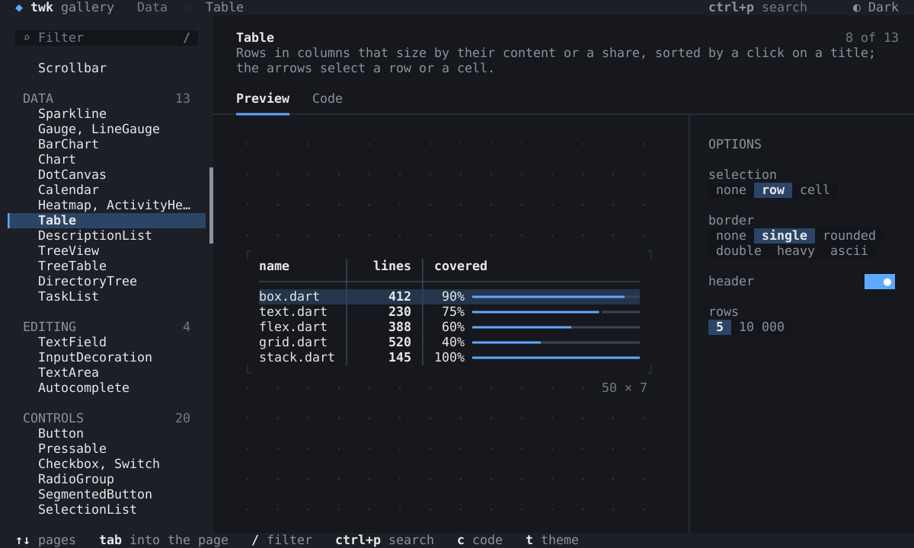

# twk — terminal UIs in Dart

twk is a **terminal widget kit**: a terminal rendering core with no
runtime dependencies, a Flutter-like widget layer on it, and the
packages around them: rich text, a console for command-line tools, a
tester, a CLI with hot reload, a terminal emulator and a web build.
Each package is under `packages/`, with a README.



`twk_core`, `twk` and `twk_test` are being prepared for pub.dev; the
other packages live in this repository only for now. The
[documentation](doc/README.md) has guides from a first app to testing, and
every widget, with its pictures and the Dart that builds it, is in the
[widget catalog](doc/widgets/README.md).

| package | what it is |
|---|---|
| [`twk_core`](packages/twk_core/README.md) | the rendering core: a packed cell buffer, a diff driven by damaged spans, a minimal ANSI stream, its own Unicode segmentation, an input parser, terminal backends for Linux, macOS, Windows and the web, and a retained render tree; fullscreen, inline and in a fixed viewport, images, plain text where the output is no terminal |
| [`twk`](packages/twk/README.md) | the widget layer: Flutter's framework over the render tree, `runApp`, layout, text, focus, the mouse, scrolling, editing, overlays and windows, navigation, controls, animations and effects, semantics and a screen-reader mode, the debug aids; and, as libraries of their own that `package:twk/twk.dart` does not export, hooks over `State` in the flutter_hooks style (`package:twk/hooks.dart`) and Provider's API (`package:twk/provider.dart`) |
| [`twk_test`](packages/twk_test/README.md) | the tester (`testTwk`: an app on a terminal in memory under a fake clock, input as a terminal's bytes, the screen read back), matchers and finders, and the strict emulator the core's tests feed |
| [`twk_rich`](packages/twk_rich/README.md) | Markdown, also as it streams in, program output with ANSI sequences, syntax highlighting, diffs, big text, QR codes and JSON as a tree that folds; and, as a library of its own that `package:twk_rich/twk_rich.dart` does not export, images (`package:twk_rich/image.dart`): PNG and JPEG decoded, scaled to cells and encoded for kitty, iTerm2 and sixel, or drawn in block characters, and the `Image` widget |
| [`twk_cli`](packages/twk_cli/README.md) | a console for command-line tools that are no app (installers, setups, deploy scripts), as the terminal, a pipe or CI takes them: messages by level, any twk widget printed, prompts that collapse into the line that answers them, a spinner or many tasks with bars, rate and ETA, a traceback for what the program throws; in place of mason_logger |
| [`twk_dev`](packages/twk_dev/README.md) | the `twk` command: `create`, `shell`, `logs`, `run` (hot reload), `inspect`, `record` and `play` |
| [`twk_riverpod`](packages/twk_riverpod/README.md) | Riverpod: a `ProviderScope` and widgets that watch providers |
| [`twk_bloc`](packages/twk_bloc/README.md) | Bloc: providers of blocs and cubits, and widgets that build on and listen to their states, on `package:twk/provider.dart` |
| [`twk_lints`](packages/twk_lints/README.md) | an analyzer plugin: warnings, lints and assists for twk apps |
| [`twk_term`](packages/twk_term/README.md) | a terminal emulator, a pseudo-terminal through dart:ffi (Linux, macOS) and `TerminalView`, a program running in a widget |
| [`twk_web`](packages/twk_web/README.md) | an app in a web page on xterm.js (`runWebApp`), built with dart2wasm |
| [`gallery`](packages/gallery/README.md) | the widget gallery: every widget of `twk`, `twk_rich` (its image library too) and `twk_term` on a page of its own, live, with its options and the Dart that builds it, and a `twk_cli` program's run as a terminal shows it (`dart run packages/gallery/bin/gallery.dart`), its own design (`packages/gallery/doc/design.md`) held by golden screens |

## The repository

The repository is one pub workspace: this directory's `pubspec.yaml`
(`twk_workspace`, no package of its own to publish) lists every package
under `packages/` and every tool's package under `tool/`, resolved
together by one `dart pub get` here, into one `pubspec.lock`. The
templates under `packages/twk_dev/templates/` stay out, apps of their
own that `twk create` copies out of the repository.

What is here besides `packages/`:

* `tool/`: the checks (`tool/xtask.dart`, the tasks of `xtask.yaml`), the
  frame benchmark (`tool/bench.dart`, its scenarios in
  `tool/frame_scenarios/`, the allocation profiler in `tool/alloc/`),
  end to end runs in a pseudo-terminal (`tool/pty_run.py`, its output
  replayed into the test emulator by `tool/replay.dart`), the web builds
  (`tool/web_check.dart`), the docs and coverage reports
  (`tool/doc_snippets/`, `tool/coverage/`) and the generator of the
  core's Unicode tables (`tool/gen_unicode.dart`);
* `test/tool/`: the tests of those tools;
* `editors/vscode/`: a VS Code extension, experimental: twk apps run and
  debugged in a terminal of its own, with hot reload and an inspector;
* `doc/`: the documentation, its index `doc/README.md`; `doc/guides/`,
  the guides, their Dart the files of `packages/twk/example/guides/`
  (`packages/twk/test/example/guides_test.dart` holds them together).
* `doc/widgets/`: the widget catalog, written from the gallery
  (`packages/gallery/tool/catalog.dart`).
* `doc/internals/`: the conventions code, docs and tests are written to
  (`quality/`) and the performance surveys against other terminal
  libraries (`perf/`).

```bash
dart pub get                                       # the whole workspace
dart run tool/xtask.dart quick                     # pub get, analyze, format
dart run tool/xtask.dart handover -j auto          # every check of a handover
dart run tool/xtask.dart --list                    # the checks, by gate
dart run packages/twk_core/example/chat_demo.dart  # the core's demo
dart run packages/gallery/bin/gallery.dart         # the widget gallery
```

[CONTRIBUTING.md](CONTRIBUTING.md) says what each check is and when the
benchmark is owed; the core's design
([packages/twk_core/doc/design/](packages/twk_core/doc/design/README.md)),
[§2](packages/twk_core/doc/design/testing.md) and
[§4](packages/twk_core/doc/design/running.md), how the end to end runs and
the benchmark work.

## License

MIT, copyright 2026 Andrii Ivanov: [LICENSE](LICENSE), and the same file
in each package. The third-party material bundled here keeps its own
licence, listed in [NOTICE](NOTICE): the Unicode data of the core's
tables, the CommonMark and GFM spec examples twk_rich's Markdown tests
run, the Nord and Catppuccin palettes of twk's themes, and the parts of
twk_rich's JPEG decoder that follow libjpeg and jpgjs.
