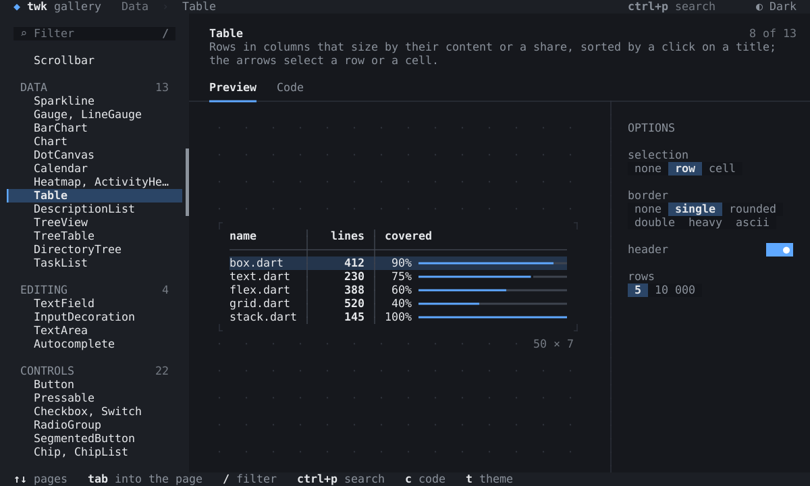

# twk

Flutter's widget model for terminal apps in Dart: widgets, layout, the mouse,
hot reload, and tests that run the real app on a fake clock.



## Getting started

```sh
dart pub global activate twk_dev
twk create my_app
cd my_app
dart pub get
dart run twk_dev:twk run bin/main.dart
```

That is a notes app, running in your terminal. Edit a file in `my_app/lib/`
and save: the app shows the change and keeps its state. Ctrl+Q quits.

To see every widget, clone this repository and run the gallery:

```sh
dart pub get
dart run packages/gallery/bin/gallery.dart
```

## Documentation

- [Guides](doc/README.md): from a first app to testing.
- [Widget catalog](doc/widgets/README.md): every widget, with its pictures and
  the Dart that builds it.

## Packages

On pub.dev:

| package | what it is |
|---|---|
| [`twk`](packages/twk/README.md) | the widgets: layout, text, input, scrolling, overlays and themes |
| [`twk_core`](packages/twk_core/README.md) | the rendering core under them, usable alone |
| [`twk_rich`](packages/twk_rich/README.md) | Markdown, syntax highlighting, diffs, JSON trees, QR codes and images |
| [`twk_test`](packages/twk_test/README.md) | tests that run the real app on a terminal in memory |
| [`twk_dev`](packages/twk_dev/README.md) | the `twk` command: `create`, `run` with hot reload, `inspect`, `logs` and more |
| [`twk_lints`](packages/twk_lints/README.md) | lints and editor assists for twk apps |
| [`twk_term`](packages/twk_term/README.md) | a terminal in a widget: run a shell or any program in your app |

In this repository:

| package | what it is |
|---|---|
| [`gallery`](packages/gallery/README.md) | every widget on a page of its own, live |
| [`twk_web`](packages/twk_web/README.md) | an app in a web page on xterm.js |
| [`twk_ssh`](packages/twk_ssh/README.md) | apps served over SSH |
| [`twk_riverpod`](packages/twk_riverpod/README.md) | Riverpod for twk apps |
| [`twk_bloc`](packages/twk_bloc/README.md) | Bloc for twk apps |

## Contributing

[CONTRIBUTING.md](CONTRIBUTING.md) says how the repository is laid out and
what the checks are.

## License

MIT, copyright 2026 Andrii Ivanov: [LICENSE](LICENSE), and the same file
in each package. The third-party material bundled here keeps its own
licence, listed in [NOTICE](NOTICE): the Unicode data of the core's
tables, the CommonMark and GFM spec examples twk_rich's Markdown tests
run, the Nord and Catppuccin palettes of twk's themes, and the parts of
twk_rich's JPEG decoder that follow libjpeg and jpgjs.
