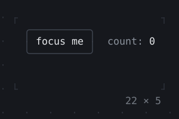

# Input and focus

A key goes first to the widget that has the focus, then up through the
layers above it — `KeyBindings`, `Shortcuts`, `Focus` with an
`onKeyEvent` — nearest first, until one takes it. Tab and Shift+Tab that
no widget takes move the focus to the next or the previous widget that
can have it.

<!-- file: packages/twk/example/guides/focus.dart -->
```dart
import 'package:twk/twk.dart';

Future<void> main() => runApp(const SignIn());

final class SignIn extends StatefulWidget {
  const SignIn({super.key});

  @override
  State<SignIn> createState() => _SignInState();
}

final class _SignInState extends State<SignIn> {
  final _name = TextEditingController();
  final _password = TextEditingController();
  var _status = '';

  @override
  void dispose() {
    _name.dispose();
    _password.dispose();
    super.dispose();
  }

  void _save() => setState(
    () => _status = _name.text.isEmpty ? 'a name, please' : 'hi, ${_name.text}',
  );

  @override
  Widget build(BuildContext context) {
    final theme = Theme.of(context);
    return KeyBindings(
      // not 'q' or 's': a focused field takes the characters typed
      {'ctrl+s': _save, 'ctrl+q': () => AppBinding.of(context).quit()},
      hints: const {'ctrl+s': 'save', 'ctrl+q': 'quit'},
      child: Box(
        style: theme.background.merge(theme.text),
        child: Column(
          crossAxisAlignment: .stretch,
          children: [
            Box(
              border: .all(type: .rounded, style: theme.border),
              titles: [BorderTitle(' Sign in ', style: theme.primary)],
              padding: const .all(1),
              child: Column(
                mainAxisSize: .min,
                crossAxisAlignment: .stretch,
                gap: 1,
                children: [
                  _Labeled(
                    'Name',
                    child: TextField(
                      controller: _name,
                      placeholder: 'who you are',
                      autofocus: true,
                    ),
                  ),
                  _Labeled(
                    'Password',
                    child: TextField(
                      controller: _password,
                      obscureText: true,
                      semanticsLabel: 'Password',
                    ),
                  ),
                  _Labeled(
                    '',
                    child: Row(
                      gap: 2,
                      children: [
                        Button('Sign in', onPressed: _save),
                        Text(_status, style: theme.muted),
                      ],
                    ),
                  ),
                ],
              ),
            ),
            const Spacer(),
            // the keys the focused widget and the bindings above it take
            const KeyHintsBar(),
          ],
        ),
      ),
    );
  }
}

/// [child] after [label], in a column of labels as wide as the longest.
final class _Labeled extends StatelessWidget {
  const _Labeled(this.label, {required this.child});

  final String label;
  final Widget child;

  @override
  Widget build(BuildContext context) => Row(
    gap: 1,
    children: [
      SizedBox(width: 8, child: Text(label)),
      Expanded(child: child),
    ],
  );
}
```

After typing `ann`, Tab, a password and Ctrl+S:

```text
╭ Sign in ─────────────────────────────╮
│                                      │
│ Name     ann                         │
│                                      │
│ Password ••••••                      │
│                                      │
│           Sign in   hi, ann          │
│                                      │
╰──────────────────────────────────────╯
ctrl+z undo   ctrl+s save   ctrl+q quit
```

## Keys

- `KeyBindings({'ctrl+s': save, 'g g': top}, child:)` binds keys by
  name for what is below it; a space between names makes a sequence.
  `hints:` names what each does for a `KeyHintsBar`, which shows the keys
  that work where the focus is now.
- A focused `TextField` takes the characters typed, so a binding above it
  for `q` never sees `q`. It lets Tab, Escape, Up, Down, Enter without
  `onSubmitted` and the Ctrl and Alt keys it does not edit with go up:
  bind `ctrl+q` rather than `q` in an app with fields.
- `Shortcuts`, `Actions` and `Intent` are Flutter's, for keys that map to
  actions a widget below decides on.
- `InputListener` gets what nobody else took: keys, pastes, resizes.

## Focus

- `autofocus: true` gives a widget the focus when it is first shown.
- A `FocusNode` (`requestFocus()`, `hasFocus`) moves it from code;
  `FocusScope` keeps Tab within a part of the app, `ExcludeFocus` keeps
  the focus out of one.
- Several keys read at once (fast typing, a paste of keys) are handled
  one after another with no build between them: a handler reads the
  state it changes, not what a build made of it.

## The mouse

Full screen, the terminal reports the mouse while a widget that needs it
is mounted: `GestureDetector` (`onTap:`, `onDoubleTap:`, `onDragUpdate:`),
`Listener`, `MouseRegion` for hovers and the pointer's shape, `Draggable`
and `DragTarget`. A click on a focusable widget focuses it. Inline, the
mouse stays the terminal's: its own selection keeps working.

| | |
| --- | --- |
| <br>**[KeyBindings, LeaderKey](../widgets/focus-and-keys/keybindings-leaderkey.md)** | <br>**[KeyHintsBar](../widgets/controls/keyhintsbar.md)** |

More in the catalog's [Focus and keys](../widgets/focus-and-keys.md) and
[Mouse](../widgets/mouse.md) groups.
