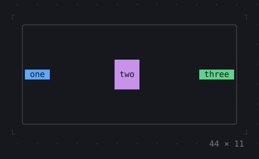
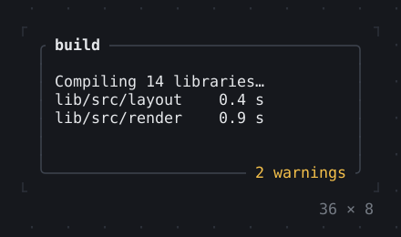
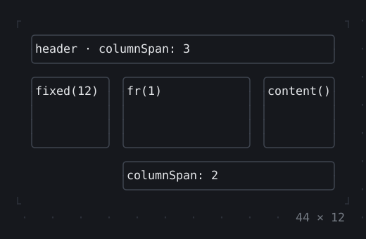
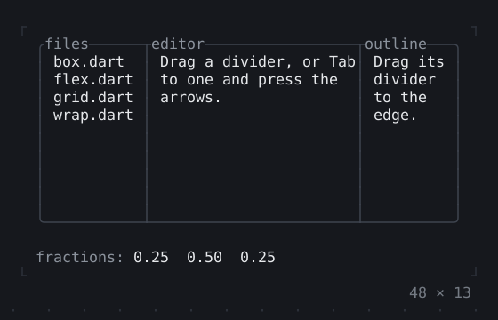

# Layout

Layout works as in Flutter: a parent gives each child constraints, the
child picks a size within them, and the parent places it. The one
difference is the unit: everything is whole cells, so sizes, paddings and
offsets are columns and rows.

## Rows and columns

<!-- file: packages/twk/example/guides/layout.dart -->
```dart
import 'package:twk/twk.dart';

Future<void> main() => runApp(const Layout());

final class Layout extends StatelessWidget {
  const Layout({super.key});

  @override
  Widget build(BuildContext context) => KeyBindings(
    {'q': () => AppBinding.of(context).quit()},
    child: Column(
      // each child as wide as the column, not centred across it
      crossAxisAlignment: .stretch,
      children: [
        Text.rich([' twk'.bold, ' · layout'.dim]),
        // the rows the title and the hints leave
        const Expanded(
          child: Row(
            crossAxisAlignment: .stretch,
            children: [
              // a fixed width
              SizedBox(
                width: 20,
                child: Box(
                  border: .all(type: .rounded),
                  titles: [BorderTitle(' Files ')],
                  padding: EdgeInsets.x(1),
                  child: Text('lib/\ntest/\npubspec.yaml'),
                ),
              ),
              // the columns the files leave
              Expanded(
                child: Box(
                  border: .all(type: .rounded),
                  titles: [BorderTitle(' Preview ')],
                  padding: EdgeInsets.x(1),
                  child: Text(
                    'Everything is measured in cells. A Row gives its '
                    'fixed children their width first, then shares what '
                    'is left among the Expanded ones.',
                  ),
                ),
              ),
            ],
          ),
        ),
        Text(' q quits', style: Theme.of(context).muted),
      ],
    ),
  );
}
```

```text
 twk · layout
╭ Files ───────────╮╭ Preview ───────────────────╮
│ lib/             ││ Everything is measured in  │
│ test/            ││ cells. A Row gives its     │
│ pubspec.yaml     ││ fixed children their width │
│                  ││ first, then shares what is │
╰──────────────────╯╰────────────────────────────╯
 q quits
```

- `Column` and `Row` lay their children out along their axis. A child
  with a fixed size gets it first; `Expanded` and `Flexible` share the
  rest by their `flex`, and `Spacer` is an empty `Expanded`. `gap:` puts
  cells between the children.
- Across their axis they centre their children unless
  `crossAxisAlignment` says otherwise: `.stretch` makes each as wide (or
  tall) as the row or column, `.start` puts them at its start.
- `SizedBox` gives a fixed size, `Padding` empty cells around a child,
  `Center` and `Align` place a child in the room it is given.
- `Box` is the workhorse: a `border:` (`.all(type: .rounded)`, or
  `.single`, `.double`, `.heavy`, `.ascii`), `titles:` on it, `padding:`
  inside it and a `style:` that fills it.

## Room that has no end

`ListView`, `Table`, `TreeView` and other scrolling widgets take all the
room they get. In a `Column` put them in `Expanded`, or they take the
whole height and push the rest off the screen (a `RenderFlex overflowed`
warning in the log). Inline, where the app's height is what it asks for, a
list asks for none: give it a height with a `SizedBox`. A list or a scroll
view left no rows records it at the debug level each time it goes to
none (not a warning: a panel closing does the same), which the debug
console (`TWK_DEBUG=console`) shows and a failing test prints.

What has no end to grow into takes its child's size instead, as in
Flutter: an `Align` or a `Center` in a scroll view, or in a list's row,
whose height has no end, is as tall as its child, so
`Align(alignment: .centerLeft, child: …)` in a row of a `ListView` keeps
the row one line tall.

## Room that is given

Where the room has an end, the same widgets take all of it.

- A `Column` or `Row` is as long as the room along its axis
  (`mainAxisSize: .max`, the default), however little its children need,
  also inside another `Column`: a header made of a `Column` of two lines,
  above a list in an `Expanded`, is as tall as the whole room and leaves
  the list no rows. A panel in a `Column` takes the screen the same way.
  Give what should be as big as its children `mainAxisSize: .min`.
- An `Align` or a `Center` with no factor is as big as the room, on both
  axes: in a `Row` that has a height (a line of a list beside other
  widgets, in a `SizedBox` or an `Expanded`) it takes the whole height.
  `heightFactor: 1` (`widthFactor: 1` along the other axis) makes it as
  tall as its child. To keep a child to the left or at the top there is
  often no `Align` to write: `crossAxisAlignment: .start` of the `Row` or
  `Column` places its children across it, `mainAxisAlignment` along it.

## A row of a list

A row with a label that gives way and something fixed after it needs no
`LayoutBuilder` and no measuring of text: `Row(children: [Expanded(child:
Text.line(label)), Text(' 12 KB')])`. The `Row` gives the fixed child its
width, `Expanded` the label the rest, and `Text.line` cuts it with `…` in
cells (wide letters whole; `Text.richLine` for spans). Columns of fixed
widths are the same with `SizedBox(width: n, child: Text.line(…))`, a
number aligned right `Text(n, align: .right, wrap: .none)`. Several rows
that share their columns, with a header, sorting and a cursor, are a
`Table`. The cursor's `▎` bar, the idle selection and the keys come from
`SelectionList` (`itemBuilder` builds the row), a title over a subtitle
with something before and after from `ListTile`.

A list that loads more near its end, or shows where it is, listens to the
scrolling as Flutter's does: a `NotificationListener<ScrollUpdateNotification>`
above it reads `metrics.extentAfter` (cells of content after the window;
`atEnd`) of the keys, the wheel, a `ScrollController` and a
`ListController` moving it, a `SelectionList`'s cursor too. A list that
all fits sends none, so ask for the first page by the size of what is
loaded.

## Text in cells

The list row above cuts a label that is on the screen. A `String` an app
holds, cut before it is a widget, is `fitText(segmenterOf(context), text, n)`:
at most `n` cells, `…` in place of the rest, no wide letter split.
`segmenterOf(context)` is the terminal's own `TextSegmenter`; a plain
`TextSegmenter()` counts a character of ambiguous width as one cell, where
an ambiguous-wide terminal counts two and the cut leaves a cell off. Use
the same for `.width(text)`, and prefer the widget wherever the text is
shown at once. A string padded to `n` cells is
`padCells(segmenterOf(context), text, n)` (`alignment:` right or center),
counted in cells, not in `length`. `fitText` cuts the end by default;
`overflow: .ellipsisStart` or `.ellipsisMiddle` cuts the start or the
middle, and `.none` clips. `breakLines(segmenterOf(context), text, n)` gives the
(start, end) offsets of the lines a text breaks into at `n` cells. A row's background across its whole width is a `ColoredBox`
around it: a `Span`'s background (`'x'.bg(color)`) paints only the cells of
its text, as in Flutter. A mark on every line a text wraps into, a quotation's
bar, is a `Box` with a border on its left only (`Border(left: Style())`;
its `type` picks the line, `BorderType.ascii` makes it `|`), and an indent
a `Padding`; the text wraps inside what they leave, wide letters and
all, and nothing is counted by hand.

A space at the end of a text is not a cell of it. With `wrap:
TextWrap.word`, the default, the spaces that end a line hang past it,
neither counted nor drawn, so `Text('◐ ')` in a `Row` is one cell wide and
the `Text` after it touches the mark. `Text('◐ ', wrap: .none)` keeps
the space: two cells. (A mark and its gap are better apart:
`Row(children: [Text(mark), SizedBox(width: 1), …])`.)

<!-- file: packages/twk/example/guides/cell_text.dart -->
```dart
import 'package:twk/twk.dart';

Future<void> main() => runApp(const CellText());

final class CellText extends StatelessWidget {
  const CellText({super.key});

  @override
  Widget build(BuildContext context) => KeyBindings(
    {'q': () => AppBinding.of(context).quit()},
    child: Column(
      crossAxisAlignment: .stretch,
      children: [
        // a String cut to 12 cells, wide letters whole
        Text(fitText(segmenterOf(context), 'Warnings (12) and 你好世界', 12)),
        // the row's background across its whole width, not under its text
        const ColoredBox(color: Color.blue, child: Text(' NORMAL ')),
        // a gutter on every line the text breaks into: a left border
        const Box(
          border: Border(left: Style()),
          padding: EdgeInsets.only(left: 1),
          child: Text('A quotation with 你好世界 that wraps over lines.'),
        ),
        // a String padded to 10 cells by the cells it takes, not its length
        Text('[${padCells(segmenterOf(context), '你好', 10)}]'),
        // a space at the end of a wrapped text hangs; with none it stays
        const Row(
          children: [
            Text('◐ '),
            Text('|'),
            Text('◐ ', wrap: .none),
            Text('|'),
          ],
        ),
      ],
    ),
  );
}
```

```text
Warnings (1…
 NORMAL
│ A quotation with
│ 你好世界 that
│ wraps over lines.
[你好      ]
◐|◐ |
```

## Limits and the room

`SizedBox` gives one size. `ConstrainedBox` keeps its child within limits
and leaves the rest to it: `BoxConstraints(minW, maxW, minH, maxH)`, in
cells, positional (twk's names, not Flutter's `maxWidth`), with
`BoxConstraints.unbounded` for a limit that limits nothing and
`BoxConstraints.tight(w, h)` for one size. Whatever is inside still gets
no more than its parent gave. `LayoutBuilder` hands its builder the
constraints it was given, `maxW` and `maxH` the room in cells, to choose
by: the app below shows the room and keeps a text to 30 cells.

<!-- file: packages/twk/example/guides/constraints.dart -->
```dart
import 'package:twk/twk.dart';

Future<void> main() => runApp(const Constraints());

final class Constraints extends StatelessWidget {
  const Constraints({super.key});

  @override
  Widget build(BuildContext context) => KeyBindings(
    {'q': () => AppBinding.of(context).quit()},
    child: LayoutBuilder(
      builder: (context, constraints) => Column(
        crossAxisAlignment: .start,
        children: [
          // the room this part of the app is given, in cells
          Text('room: ${constraints.maxW} x ${constraints.maxH}'),
          // minW, maxW, minH, maxH: at most 30 wide, any height
          const ConstrainedBox(
            constraints: BoxConstraints(10, 30, 0, BoxConstraints.unbounded),
            child: Box(
              border: .all(type: .rounded),
              child: Text(
                'A message that wraps at thirty cells, however wide the '
                'terminal is.',
              ),
            ),
          ),
        ],
      ),
    ),
  );
}
```

```text
room: 50 x 8
╭──────────────────────────╮
│A message that wraps at   │
│thirty cells, however wide│
│the terminal is.          │
╰──────────────────────────╯
```

A `LayoutBuilder` builds again when its constraints change, as a resize
does; the [hints](#hints-that-depend-on-the-layout) below choose a layout
with one.

## Hints that depend on the layout

`KeyHintsBar` shows the keys of the `KeyBindings` on the path of the
focus. A key that exists only in one layout, `s` here when the panes are
side by side, belongs to a `KeyBindings` below the `LayoutBuilder`, which
knows the layout: its binding is null in the other one, and a key bound to
null is no key, so the bar leaves it out and the key does nothing. The
layer is always there, so the focus inside it stays where it is as the
terminal is resized. The bar follows a resize a frame later: the
`LayoutBuilder` builds in the layout of the frame the resize draws, and the
keys it changes are built in the frame after, which is asked for at once.

<!-- file: packages/twk/example/guides/hints.dart -->
```dart
import 'package:twk/twk.dart';

Future<void> main() => runApp(const Hints());

final class Hints extends StatefulWidget {
  const Hints({super.key});

  @override
  State<Hints> createState() => _HintsState();
}

final class _HintsState extends State<Hints> {
  var _swapped = false;

  @override
  Widget build(BuildContext context) => KeyBindings(
    {'q': () => AppBinding.of(context).quit()},
    hints: const {'q': 'quit'},
    child: Column(
      crossAxisAlignment: .stretch,
      children: [
        Expanded(
          child: LayoutBuilder(
            builder: (context, constraints) {
              final wide = constraints.maxW >= 40;
              const one = Box(child: Text('one'));
              const two = Box(child: Text('two'));
              // below the LayoutBuilder, so the layout decides the key; the
              // layer stays in the tree, only its key comes and goes
              return KeyBindings(
                // null in a narrow layout: no key, so no hint
                {'s': wide ? () => setState(() => _swapped = !_swapped) : null},
                hints: const {'s': 'swap'},
                child: Focus(
                  autofocus: true,
                  child: wide
                      ? Row(
                          children: [
                            Expanded(child: _swapped ? two : one),
                            Expanded(child: _swapped ? one : two),
                          ],
                        )
                      : one,
                ),
              );
            },
          ),
        ),
        const KeyHintsBar(),
      ],
    ),
  );
}
```

A `KeyBindings` above the `LayoutBuilder` has no layout to ask, and shows
its hint in every one.

## More layouts

| | |
| --- | --- |
| <br>**[Row, Column, Flex](../widgets/layout/row-column-flex.md)** | <br>**[Box](../widgets/layout/box.md)** |
| <br>**[Grid, GridPlacement](../widgets/layout/grid-gridplacement.md)** | <br>**[SplitView](../widgets/layout/splitview.md)** |

`Stack` and `Positioned` layer children, `Wrap` flows them onto the next
row, `Grid` places them in tracks whose borders can merge, and
`SplitView` gives panes a divider the mouse drags. All of them are in the
catalog's [Layout](../widgets/layout.md) group.
