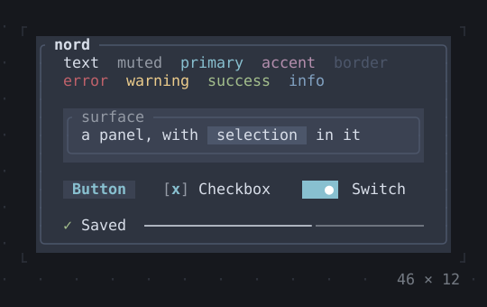
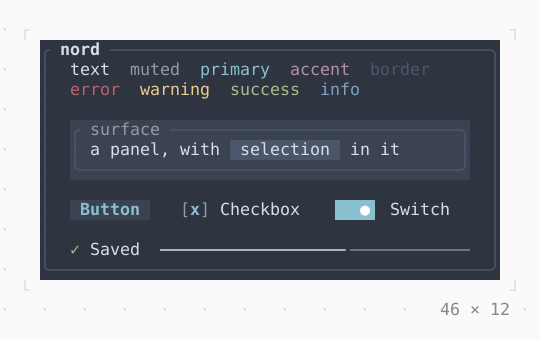

# Theming

A `Theme` gives the widgets below it a `ThemeData`: a background, text,
`muted`, `primary`, `accent`, `border`, `selection`, and `success`,
`warning`, `error` and `info`, each a `Style`. Every widget of twk draws
in them, and `Theme.of(context)` gives them to an app's own.

<!-- file: packages/twk/example/guides/theming.dart -->
```dart
import 'package:twk/twk.dart';

Future<void> main() => runApp(
  // Catppuccin's dark flavor on a dark terminal, its light one on a light
  // one, switched when the terminal reports another color scheme; without
  // a Theme, ThemeData.dark and ThemeData.light
  const Theme.adaptive(
    dark: ThemeData.catppuccinMocha,
    light: ThemeData.catppuccinLatte,
    child: Status(),
  ),
);

final class Status extends StatelessWidget {
  const Status({super.key});

  @override
  Widget build(BuildContext context) {
    final theme = Theme.of(context);
    return KeyBindings(
      {'q': () => AppBinding.of(context).quit()},
      child: Box(
        border: .all(type: .rounded, style: theme.border),
        titles: [BorderTitle(' Services ', style: theme.primary)],
        padding: const .all(1),
        child: Column(
          crossAxisAlignment: .start,
          children: [
            Text.rich([Span('● ', theme.success), const Span('api      up')]),
            Text.rich([Span('● ', theme.warning), const Span('worker   slow')]),
            Text.rich([Span('● ', theme.error), const Span('mail     down')]),
            Text('q quits', style: theme.muted),
          ],
        ),
      ),
    );
  }
}
```

## Which theme

- `Theme(data: ThemeData.nord, child:)` sets one theme. Built in:
  `ThemeData.dark`, `.light`, `.nord`, `.catppuccinMocha`,
  `.catppuccinLatte`.
- Without a `Theme`, the widgets use twk's own: `ThemeData.dark` on a
  terminal with a dark background, `ThemeData.light` on a light one,
  switched as soon as the terminal reports that its color scheme
  changed. Its colors are RGB, brought down to 256 or 16 where the
  terminal shows no more. A terminal that does not answer for its
  background gets its own colors, as under `Theme.terminal`, their greys
  for the side its `COLORFGBG` names (rxvt, Konsole), dark where it names
  none: a guess, and an inherited variable can be stale (in tmux, after a
  profile changed), so it never picks twk's themes, whose dark theme on a
  light terminal would be light text on white.
- `Theme.adaptive(dark:, light:, child:)` chooses the dark and the light
  theme, as the app above does.
- `Theme.terminal(child:)` uses the terminal's own colors
  (`ThemeData.terminalOf`): the user's palette, `primary` blue, and
  `surface` (toasts, dialogs, menus), `muted`, `border` and the
  selections greys mixed from the background
  and text color the terminal told, a step from its background whatever
  it is, and a color of the palette its bright entry where only that one
  reads on the background; where it told none, greys of the 256 colors,
  which no color scheme changes. For an app that should look like
  the rest of the user's terminal.

## Glyphs

The marks the widgets draw (a check, a cross, a cursor bar, the arrows of
a tree, a scrollbar's thumb and track, the line of a gauge, the frames of
a spinner) are the theme's too, `ThemeData.glyphs`, a `Glyphs` set named
by what a mark means and not by the widget that shows it. `Glyphs.unicode`
is the default; `Glyphs.ascii` is for a terminal or a font without them
(a `#` thumb on a `|` track, `=` for a gauge's filled part, `v` for a
check, `>` for what is closed); `copyWith` changes some marks of a set.
For the whole app a `ThemeData.copyWith(glyphs:)` does it, for one part of
it a `Theme` around that part. A widget's own parameter for a mark it has
(`Spinner.frames`, `RadioGroup.mark`, `StatusMessage.icon`, a `LineGauge`'s
`type`) stays above the set. Borders are in it: a `Border`, a `Divider`, a
`SplitView` or a `Callout` given no `BorderType` draws `Glyphs.lines`, and in
`Glyphs.ascii` every type is ASCII, a `rounded` or a `heavy` too, so one
`ThemeData.copyWith(glyphs: Glyphs.ascii)` makes the whole app ASCII but its
images. Charts are in it too: with no `partialBlocks`, bars are drawn in the
`shades` ramp and a canvas's dots as the shade as dense as their number; and
so is the ellipsis a `Text` or a `Box` title is cut with (`...`, three
columns, taken from the room). A mark takes one column and one code point; one that is wider,
or a letter with a combining accent, is the `Glyphs.ascii` mark in its place,
with one warning in the log for each, so an emoji in a `copyWith` is drawn
where the terminal gives it one cell and is ASCII where it does not.

<!-- file: packages/twk/example/guides/glyphs.dart -->
```dart
import 'package:twk/twk.dart';

Future<void> main() => runApp(
  // ASCII all through, but a plus for a check: the marks widgets draw
  // are the theme's Glyphs
  Theme(
    data: ThemeData.dark.copyWith(
      glyphs: Glyphs.ascii.copyWith(check: '+'),
    ),
    child: const Report(),
  ),
);

final class Report extends StatelessWidget {
  const Report({super.key});

  @override
  Widget build(BuildContext context) => KeyBindings(
    {'q': () => AppBinding.of(context).quit()},
    child: const Column(
      crossAxisAlignment: .start,
      children: [
        StatusMessage('Built in 2 s', kind: StatusKind.success),
        StatusMessage('3 files skipped', kind: StatusKind.warning),
        LineGauge(ratio: 0.6, label: 'upload '),
        Checkbox(value: true, onChanged: null, label: 'Publish'),
      ],
    ),
  );
}
```

## Styles and spans

- `Style(fg:, bg:, attrs:)` is a color for the text, one for the
  background and attributes: `Attr.bold`, `dim`, `italic`, `underline`
  (and curly, dotted, dashed and double), `reverse`, `strike`. A `Color`
  is one of the 16 named ones, an index of the 256, or `Color.rgb`; the
  terminal's own depth decides what is written.
- `Text('Ready', style: theme.success)` styles a whole text;
  `Text.rich([...])` a row of spans, `Span('● ', theme.success)` or the
  short forms on a string: `'q'.bold`, `'down'.fg(.red)`, `'docs'.link(url)`.
- `DefaultTextStyle` sets the style of the text below it, which a `Text`
  merges its own over.

| | |
| --- | --- |
| <br>**[Theme](../widgets/style/theme.md)** | <br>**[Theme](../widgets/style/theme.md)**, light |

Gradients across a background or text, and how the brightness is read,
are in the catalog's [Style](../widgets/style.md) group.
