# Widget catalog

Every widget of [twk](../../packages/twk/README.md), and those of
[twk_rich](../../packages/twk_rich/README.md),
[twk_term](../../packages/twk_term/README.md) and
[twk_cli](../../packages/twk_cli/README.md) the gallery shows, by group.
Each has a page of its own: its pictures in the dark and the light theme,
the Dart that builds it, its options in the gallery and links to its API.
The pictures are the gallery's golden screens; to see a widget live, run
the gallery, `dart run packages/gallery/bin/gallery.dart`.

| | |
| --- | --- |
| [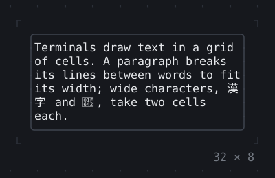](text.md) **[Text](text.md)** Paragraphs and spans of styled text, wrapped, cut off, aligned, and right to left. 4 pages. | [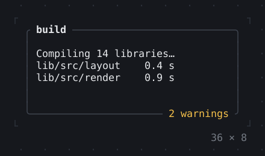](layout.md) **[Layout](layout.md)** Boxes, rows and columns, stacks, grids and wraps: where a child goes and how much room it gets. 24 pages. |
|  **[Style](style.md)** Themes, the terminal’s brightness, and colors that run across a background or text. 4 pages. |  **[Scrolling](scrolling.md)** Lists, scroll views and scrollbars, built as they scroll into view. 5 pages. |
| [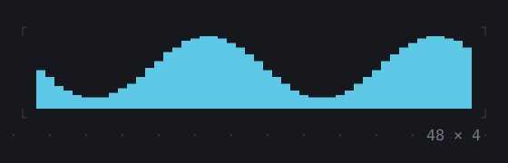](data.md) **[Data](data.md)** Tables, trees, charts, gauges, sparklines and calendars. 13 pages. | [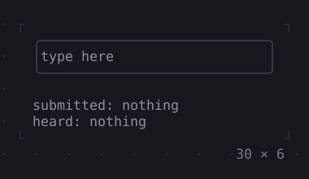](editing.md) **[Editing](editing.md)** Text fields and what is drawn around them, text areas and completion as the user types. 4 pages. |
| [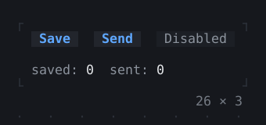](controls.md) **[Controls](controls.md)** Buttons, checkboxes and switches, choices, sliders, forms, tabs and status bars. 20 pages. |  **[Overlays](overlays.md)** Dialogs, toasts, tooltips, popovers, menus and the command palette, over the app. 11 pages. |
| [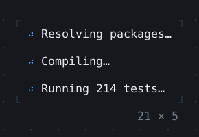](animation.md) **[Animation](animation.md)** Spinners, progress, and widgets that animate as their values change. 16 pages. | [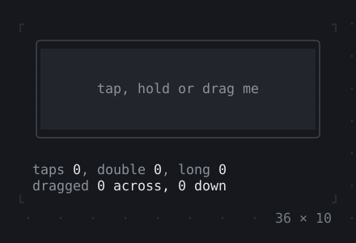](mouse.md) **[Mouse](mouse.md)** Clicks, drags, hovers and the wheel, and where the mouse is let through. 5 pages. |
| [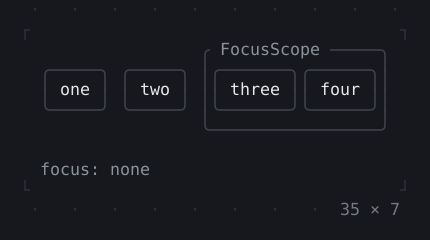](focus-and-keys.md) **[Focus and keys](focus-and-keys.md)** The focus, moved by Tab and the mouse, and the keys bound where it is. 5 pages. |  **[Navigation](navigation.md)** Routes, a scaffold of panes, steppers, breadcrumbs and pages. 5 pages. |
| [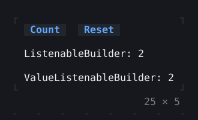](foundation.md) **[Foundation](foundation.md)** Notifiers and listenables that widgets build on. 2 pages. | [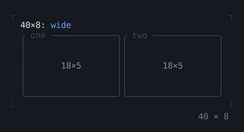](framework.md) **[Framework](framework.md)** Stateful and inherited widgets, builders, keys and the element tree. 3 pages. |
| [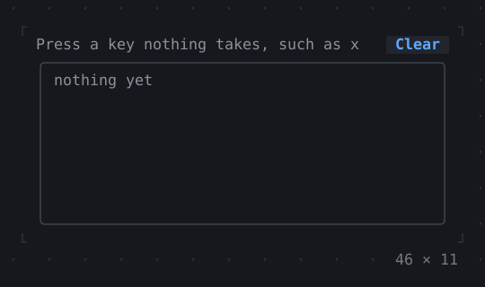](app.md) **[App](app.md)** The app around it all: the screen modes, a fixed viewport, output kept in the scrollback, the window title, notifications and a command-line tool’s console. 8 pages. |  **[Screen readers](screen-readers.md)** What the widgets are to a screen reader. One page. |
| [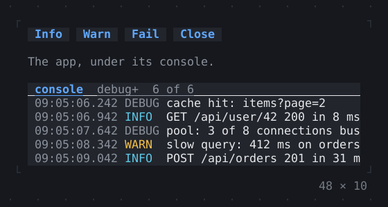](debugging.md) **[Debugging](debugging.md)** The log console, the frame overlay, the repaint rainbow and repaint boundaries. 4 pages. | [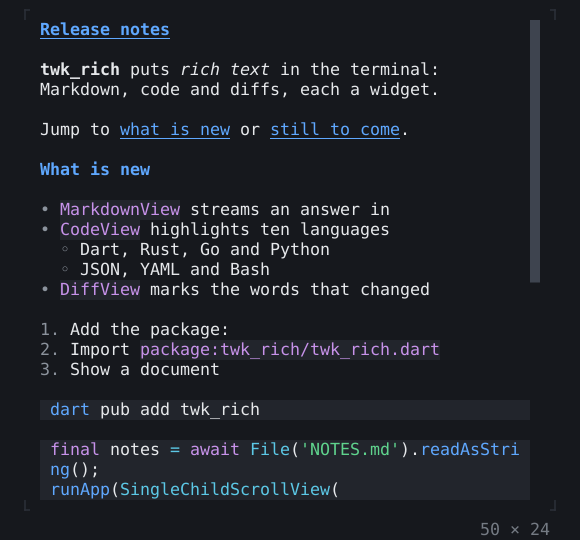](rich.md) **[Rich](rich.md)** Markdown, code, diffs, JSON, big text, QR codes and program output with its colors. 8 pages. |
|  **[Images](images.md)** PNG and JPEG pictures, in the terminal’s graphics or in block characters. One page. | [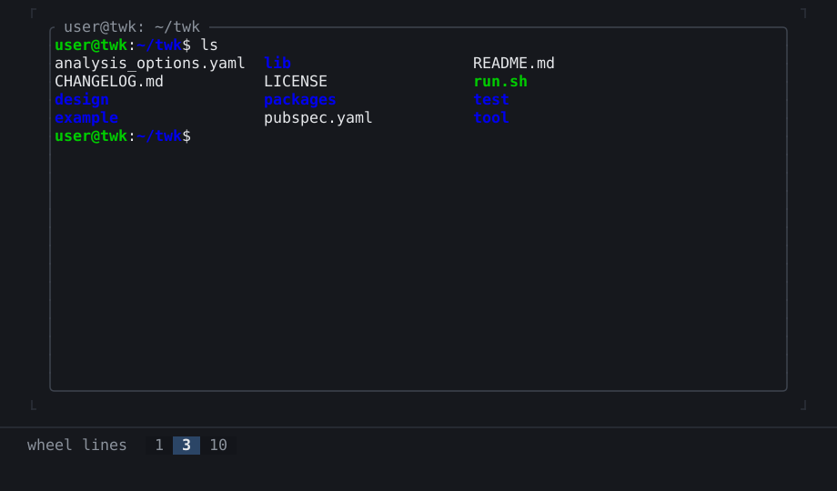](terminal.md) **[Terminal](terminal.md)** A program running in a widget, on a pseudo-terminal. One page. |

