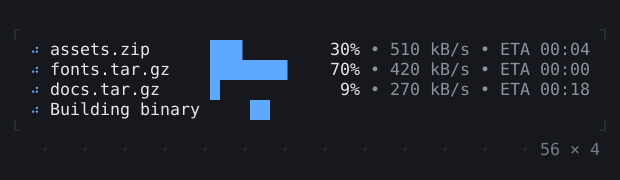
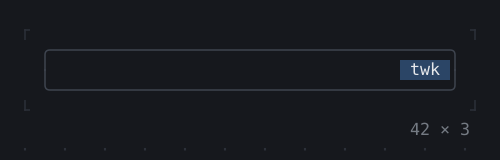

# Animation

Spinners, progress, and widgets that animate as their values change.

[All groups](README.md)

| | |
| --- | --- |
|  **[Spinner](animation/spinner.md)** Frames shown in turn while something goes on; spinners of the same frames step together. |  **[ProgressBar](animation/progressbar.md)** A bar filled as far as its value, in eighths of a cell; a block going to and fro while the value is not known. |
|  **[ProgressList](animation/progresslist.md)** Many tasks at once, a row each: its mark, a bar, how much is done, its rate and the time it has left, from a ProgressTracker the work counts on. |  **[Skeleton, Skeletonize](animation/skeleton-skeletonize.md)** Placeholders while content loads: blocks where it will be, or a subtree drawn as blocks in the layout it has, a shimmer sweeping over them as a SkeletonTheme says. |
|  **[AnimationController](animation/animationcontroller.md)** An animation of the page's own: a controller from 0 to 1 and back, a frame at a time, through a curve and a tween. |  **[AnimatedBuilder](animation/animatedbuilder.md)** A builder run again at each tick of an animation, the part that does not change built once and passed in as its child. |
|  **[AnimatedAlign, AnimatedPadding](animation/animatedalign-animatedpadding.md)** A child that runs to the place its alignment or its padding gives it, a cell at a time. |  **[AnimatedPositioned](animation/animatedpositioned.md)** A child pinned in a stack that runs to the edges it is pinned to. |
|  **[AnimatedBox](animation/animatedbox.md)** A box whose size, padding, background and border colors run to the new ones; a border of another type switches halfway. |  **[AnimatedOpacity, Opacity](animation/animatedopacity-opacity.md)** A child shown at an opacity, mixed cell by cell with what is under it; the one on the left runs to the opacity chosen. |
|  **[AnimatedDefaultTextStyle](animation/animateddefaulttextstyle.md)** The style of the text below it, its colors running to the new ones. |  **[AnimatedSize](animation/animatedsize.md)** As big as its child, running to the new size when the child grows or shrinks. |
|  **[TweenAnimationBuilder](animation/tweenanimationbuilder.md)** Builds with a value that runs to the one it is given, through the tweens it makes. |  **[AnimatedSwitcher](animation/animatedswitcher.md)** A child that gives way to another as the transition shows them: faded, slid or dissolved. |
|  **[Dissolve, FractionalTranslation](animation/dissolve-fractionaltranslation.md)** What the transitions are made of: a share of the cells of a child, and a child moved a share of its size. |  **[Effect](animation/effect.md)** A child shown through an effect over its cells, run on the app's clock: recolored, swept, dissolved, typed or glitched in, while the child repaints underneath. |

