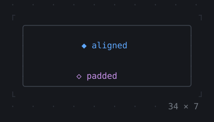
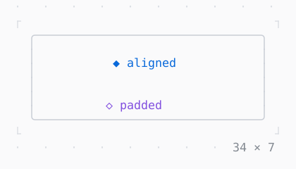

# AnimatedAlign, AnimatedPadding

A child that runs to the place its alignment or its padding gives it, a cell at a time.

| Dark | Light |
| --- | --- |
|  |  |

## Code

The Dart that builds it, as the gallery's Code tab shows it with the
options as they start:

```dart
static const _alignments = <Alignment>[
  .centerLeft,
  .center,
  .centerRight,
  .bottomRight,
];
var _i = 0;
late final Timer _timer;

@override
void initState() {
  super.initState();
  // the next alignment every 1.2 s
  _timer = Timer.periodic(
    const Duration(milliseconds: 1200),
    (_) => setState(() => _i = (_i + 1) % _alignments.length),
  );
}

@override
void dispose() {
  _timer.cancel();
  super.dispose();
}

@override
Widget build(BuildContext context) {
  final alignment = _alignments[_i];
  final theme = Theme.of(context);
  return SizedBox(
    width: 34,
    height: 7,
    child: Box(
      border: .all(type: .rounded, style: theme.border),
      child: Column(
        crossAxisAlignment: .start,
        children: [
          Expanded(
            child: AnimatedAlign(
              alignment: alignment,
              duration: const Duration(milliseconds: 600),
              curve: Curves.easeInOut,
              child: Text('◆ aligned', style: theme.primary),
            ),
          ),
          AnimatedPadding(
            padding: .only(left: alignment.x * 10 + 10),
            duration: const Duration(milliseconds: 600),
            curve: Curves.easeInOut,
            child: Text('◇ padded', style: theme.accent),
          ),
        ],
      ),
    ),
  );
}
```

## Options

What the gallery lets you change, and what each starts at:

| option | values | starts at |
| --- | --- | --- |
| alignment | centerLeft, center, centerRight, bottomRight | centerLeft |
| curve | linear, ease, easeIn, easeOut, easeInOut, fastOutSlowIn, decelerate, bounceOut, elasticOut | easeInOut |
| cycle | on, off | true |

## More

- API: [`AnimatedAlign`](https://pub.dev/documentation/twk/latest/twk/AnimatedAlign-class.html), [`AnimatedPadding`](https://pub.dev/documentation/twk/latest/twk/AnimatedPadding-class.html).
- Also in Animation: [Spinner](spinner.md), [ProgressBar](progressbar.md), [ProgressList](progresslist.md), [Skeleton, Skeletonize](skeleton-skeletonize.md), [AnimationController](animationcontroller.md), [AnimatedBuilder](animatedbuilder.md), [AnimatedPositioned](animatedpositioned.md), [AnimatedBox](animatedbox.md), [AnimatedOpacity, Opacity](animatedopacity-opacity.md), [AnimatedDefaultTextStyle](animateddefaulttextstyle.md), [AnimatedSize](animatedsize.md), [TweenAnimationBuilder](tweenanimationbuilder.md), [AnimatedSwitcher](animatedswitcher.md), [Dissolve, FractionalTranslation](dissolve-fractionaltranslation.md), [Effect](effect.md).
- Live in the gallery:
  `dart run packages/gallery/bin/gallery.dart --route='#/animation/animatedalign-animatedpadding'`.
- [Animation](../animation.md) · [All groups](../README.md)
