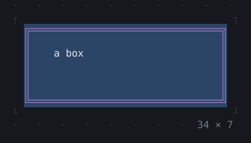
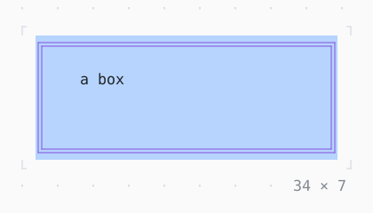

# AnimatedBox

A box whose size, padding, background and border colors run to the new ones; a border of another type switches halfway.

| Dark | Light |
| --- | --- |
|  |  |

## Code

The Dart that builds it, as the gallery's Code tab shows it with the
options as they start:

```dart
var _big = false;
late final Timer _timer;

@override
void initState() {
  super.initState();
  // big, then small again, every 1.2 s
  _timer = Timer.periodic(
    const Duration(milliseconds: 1200),
    (_) => setState(() => _big = !_big),
  );
}

@override
void dispose() {
  _timer.cancel();
  super.dispose();
}

@override
Widget build(BuildContext context) {
  final big = _big;
  final theme = Theme.of(context);
  // the room it grows in: the box at its biggest
  return SizedBox(
    width: 34,
    height: 7,
    child: Align(
      alignment: .topLeft,
      child: AnimatedBox(
        width: big ? 34 : 16,
        height: big ? 7 : 3,
        style: big ? theme.selection : theme.surface,
        border: .all(
          type: big ? .double : .rounded,
          style: big ? theme.accent : theme.border,
        ),
        padding: big ? const .only(left: 4, top: 1) : .zero,
        duration: const Duration(milliseconds: 600),
        curve: Curves.easeInOut,
        child: const Text('a box'),
      ),
    ),
  );
}
```

## Options

What the gallery lets you change, and what each starts at:

| option | values | starts at |
| --- | --- | --- |
| big | on, off | false |
| curve | linear, ease, easeIn, easeOut, easeInOut, fastOutSlowIn, decelerate, bounceOut, elasticOut | easeInOut |
| cycle | on, off | true |

## More

- API: [`AnimatedBox`](https://pub.dev/documentation/twk/latest/twk/AnimatedBox-class.html).
- Also in Animation: [Spinner](spinner.md), [ProgressBar](progressbar.md), [ProgressList](progresslist.md), [Skeleton, Skeletonize](skeleton-skeletonize.md), [AnimationController](animationcontroller.md), [AnimatedBuilder](animatedbuilder.md), [AnimatedAlign, AnimatedPadding](animatedalign-animatedpadding.md), [AnimatedPositioned](animatedpositioned.md), [AnimatedOpacity, Opacity](animatedopacity-opacity.md), [AnimatedDefaultTextStyle](animateddefaulttextstyle.md), [AnimatedSize](animatedsize.md), [TweenAnimationBuilder](tweenanimationbuilder.md), [AnimatedSwitcher](animatedswitcher.md), [Dissolve, FractionalTranslation](dissolve-fractionaltranslation.md), [Effect](effect.md).
- Live in the gallery:
  `dart run packages/gallery/bin/gallery.dart --route='#/animation/animatedbox'`.
- [Animation](../animation.md) · [All groups](../README.md)
