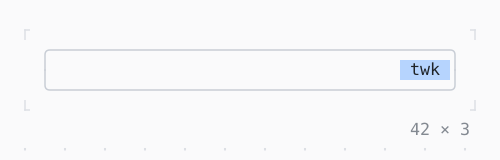

# AnimatedBuilder

A builder run again at each tick of an animation, the part that does not change built once and passed in as its child.

| Dark | Light |
| --- | --- |
|  |  |

## Code

The Dart that builds it, as the gallery's Code tab shows it with the
options as they start:

```dart
final class _SlideState extends State<_Slide>
    with TickerProviderStateMixin {
  late final _controller = AnimationController(
    vsync: this,
    duration: const Duration(seconds: 2),
  )..repeat(reverse: true);

  static final _across = IntTween(begin: 0, end: 35).chain(
    Curves.easeInOut,
  );

  @override
  void dispose() {
    _controller.dispose();
    super.dispose();
  }

  @override
  Widget build(BuildContext context) {
    final theme = Theme.of(context);
    return SizedBox(
      width: 42,
      child: Box(
        border: .all(type: .rounded, style: theme.border),
        child: AnimatedBuilder(
          animation: _controller,
          // at each tick: the chip moved along the track
          builder: (context, child) => Row(
            children: [
              SizedBox(width: _across.evaluate(_controller)),
              child!,
            ],
          ),
          // built once, here, and handed to the builder at each tick
          child: Box(
            style: theme.selection,
            padding: const .x(1),
            child: const Text('twk'),
          ),
        ),
      ),
    );
  }
}
```

## Options

What the gallery lets you change, and what each starts at:

| option | values | starts at |
| --- | --- | --- |
| curve | linear, ease, easeIn, easeOut, easeInOut, fastOutSlowIn, decelerate, bounceOut, elasticOut | easeInOut |
| reverse | on, off | true |
| duration | 1 s, 2 s, 4 s | 2 s |

## More

- API: [`AnimatedBuilder`](https://pub.dev/documentation/twk/latest/twk/AnimatedBuilder-class.html).
- Also in Animation: [Spinner](spinner.md), [ProgressBar](progressbar.md), [ProgressList](progresslist.md), [Skeleton, Skeletonize](skeleton-skeletonize.md), [AnimationController](animationcontroller.md), [AnimatedAlign, AnimatedPadding](animatedalign-animatedpadding.md), [AnimatedPositioned](animatedpositioned.md), [AnimatedBox](animatedbox.md), [AnimatedOpacity, Opacity](animatedopacity-opacity.md), [AnimatedDefaultTextStyle](animateddefaulttextstyle.md), [AnimatedSize](animatedsize.md), [TweenAnimationBuilder](tweenanimationbuilder.md), [AnimatedSwitcher](animatedswitcher.md), [Dissolve, FractionalTranslation](dissolve-fractionaltranslation.md), [Effect](effect.md).
- Live in the gallery:
  `dart run packages/gallery/bin/gallery.dart --route='#/animation/animatedbuilder'`.
- [Animation](../animation.md) · [All groups](../README.md)
