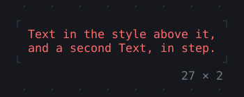
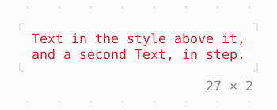

# AnimatedDefaultTextStyle

The style of the text below it, its colors running to the new ones.

| Dark | Light |
| --- | --- |
|  |  |

## Code

The Dart that builds it, as the gallery's Code tab shows it with the
options as they start:

```dart
var _i = 0;
late final Timer _timer;

@override
void initState() {
  super.initState();
  // the next style every 1.2 s
  _timer = Timer.periodic(
    const Duration(milliseconds: 1200),
    (_) => setState(() => _i = (_i + 1) % 3),
  );
}

@override
void dispose() {
  _timer.cancel();
  super.dispose();
}

@override
Widget build(BuildContext context) {
  final theme = Theme.of(context);
  final slot = [theme.primary, theme.error, theme.success][_i];
  return AnimatedDefaultTextStyle(
    style: slot,
    duration: const Duration(milliseconds: 600),
    child: const Column(
      mainAxisSize: .min,
      crossAxisAlignment: .start,
      children: [
        Text('Text in the style above it,'),
        Text('and a second Text, in step.'),
      ],
    ),
  );
}
```

## Options

What the gallery lets you change, and what each starts at:

| option | values | starts at |
| --- | --- | --- |
| style | primary, error, success | primary |
| bold | on, off | false |
| cycle | on, off | true |

## More

- API: [`AnimatedDefaultTextStyle`](https://pub.dev/documentation/twk/latest/twk/AnimatedDefaultTextStyle-class.html).
- Also in Animation: [Spinner](spinner.md), [ProgressBar](progressbar.md), [ProgressList](progresslist.md), [Skeleton, Skeletonize](skeleton-skeletonize.md), [AnimationController](animationcontroller.md), [AnimatedBuilder](animatedbuilder.md), [AnimatedAlign, AnimatedPadding](animatedalign-animatedpadding.md), [AnimatedPositioned](animatedpositioned.md), [AnimatedBox](animatedbox.md), [AnimatedOpacity, Opacity](animatedopacity-opacity.md), [AnimatedSize](animatedsize.md), [TweenAnimationBuilder](tweenanimationbuilder.md), [AnimatedSwitcher](animatedswitcher.md), [Dissolve, FractionalTranslation](dissolve-fractionaltranslation.md), [Effect](effect.md).
- Live in the gallery:
  `dart run packages/gallery/bin/gallery.dart --route='#/animation/animateddefaulttextstyle'`.
- [Animation](../animation.md) · [All groups](../README.md)
