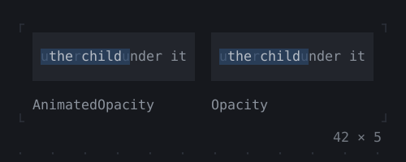
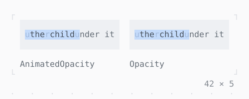

# AnimatedOpacity, Opacity

A child shown at an opacity, mixed cell by cell with what is under it; the one on the left runs to the opacity chosen.

| Dark | Light |
| --- | --- |
|  |  |

## Code

The Dart that builds it, as the gallery's Code tab shows it with the
options as they start:

```dart
static const _opacities = [0.0, 0.25, 0.5, 0.75, 1.0];
var _i = 2;
late final Timer _timer;

@override
void initState() {
  super.initState();
  // the next opacity every 1.2 s
  _timer = Timer.periodic(
    const Duration(milliseconds: 1200),
    (_) => setState(() => _i = (_i + 1) % _opacities.length),
  );
}

@override
void dispose() {
  _timer.cancel();
  super.dispose();
}

@override
Widget build(BuildContext context) {
  final opacity = _opacities[_i];
  final theme = Theme.of(context);
  Widget over(Widget child, String name) => Column(
    mainAxisSize: .min,
    crossAxisAlignment: .start,
    gap: 1,
    children: [
      Box(
        style: theme.surface,
        padding: const .all(1),
        child: Stack(
          children: [
            Text('under it, under it', style: theme.muted),
            child,
          ],
        ),
      ),
      Text(name, style: theme.muted),
    ],
  );
  final shown = Box(
    style: theme.selection,
    padding: const .x(1),
    child: Text('the child', style: theme.text),
  );
  return Row(
    mainAxisSize: .min,
    gap: 2,
    children: [
      over(
        AnimatedOpacity(
          opacity: opacity,
          duration: const Duration(milliseconds: 600),
          child: shown,
        ),
        'AnimatedOpacity',
      ),
      over(Opacity(opacity: opacity, child: shown), 'Opacity'),
    ],
  );
}
```

## Options

What the gallery lets you change, and what each starts at:

| option | values | starts at |
| --- | --- | --- |
| opacity | 0, ¼, ½, ¾, 1 | ½ |
| cycle | on, off | true |

## More

- API: [`AnimatedOpacity`](https://pub.dev/documentation/twk/latest/twk/AnimatedOpacity-class.html), [`Opacity`](https://pub.dev/documentation/twk/latest/twk/Opacity-class.html).
- Also in Animation: [Spinner](spinner.md), [ProgressBar](progressbar.md), [ProgressList](progresslist.md), [Skeleton, Skeletonize](skeleton-skeletonize.md), [AnimationController](animationcontroller.md), [AnimatedBuilder](animatedbuilder.md), [AnimatedAlign, AnimatedPadding](animatedalign-animatedpadding.md), [AnimatedPositioned](animatedpositioned.md), [AnimatedBox](animatedbox.md), [AnimatedDefaultTextStyle](animateddefaulttextstyle.md), [AnimatedSize](animatedsize.md), [TweenAnimationBuilder](tweenanimationbuilder.md), [AnimatedSwitcher](animatedswitcher.md), [Dissolve, FractionalTranslation](dissolve-fractionaltranslation.md), [Effect](effect.md).
- Live in the gallery:
  `dart run packages/gallery/bin/gallery.dart --route='#/animation/animatedopacity-opacity'`.
- [Animation](../animation.md) · [All groups](../README.md)
