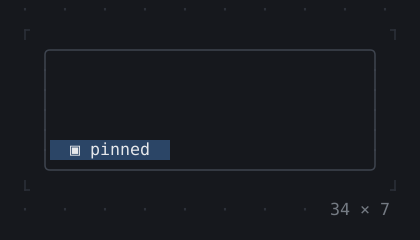
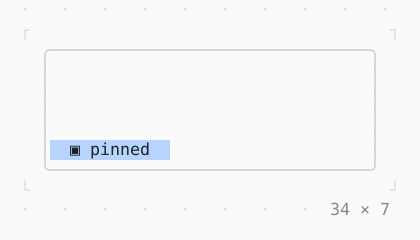

# AnimatedPositioned

A child pinned in a stack that runs to the edges it is pinned to.

| Dark | Light |
| --- | --- |
|  |  |

## Code

The Dart that builds it, as the gallery's Code tab shows it with the
options as they start:

```dart
// left, top, width, height
static const _pins = [
  (1, 1, 12, 1), // topLeft
  (1, 5, 12, 1), // bottomLeft
  (21, 5, 12, 1), // bottomRight
  (21, 1, 12, 1), // topRight
  (1, 1, 32, 5), // fill
];
var _i = 0;
late final Timer _timer;

@override
void initState() {
  super.initState();
  // pinned elsewhere every 1.2 s
  _timer = Timer.periodic(
    const Duration(milliseconds: 1200),
    (_) => setState(() => _i = (_i + 1) % _pins.length),
  );
}

@override
void dispose() {
  _timer.cancel();
  super.dispose();
}

@override
Widget build(BuildContext context) {
  final (left, top, width, height) = _pins[_i];
  final theme = Theme.of(context);
  return SizedBox(
    width: 34,
    height: 7,
    child: Stack(
      fit: .expand,
      children: [
        Box(
          border: .all(type: .rounded, style: theme.border),
        ),
        AnimatedPositioned(
          left: left,
          top: top,
          width: width,
          height: height,
          duration: const Duration(milliseconds: 600),
          curve: Curves.easeInOut,
          child: Box(
            style: theme.selection,
            child: const Center(child: Text('▣ pinned')),
          ),
        ),
      ],
    ),
  );
}
```

## Options

What the gallery lets you change, and what each starts at:

| option | values | starts at |
| --- | --- | --- |
| pinned | topLeft, bottomLeft, bottomRight, topRight, fill | topLeft |
| curve | linear, ease, easeIn, easeOut, easeInOut, fastOutSlowIn, decelerate, bounceOut, elasticOut | easeInOut |
| cycle | on, off | true |

## More

- API: [`AnimatedPositioned`](https://pub.dev/documentation/twk/latest/twk/AnimatedPositioned-class.html).
- Also in Animation: [Spinner](spinner.md), [ProgressBar](progressbar.md), [ProgressList](progresslist.md), [Skeleton, Skeletonize](skeleton-skeletonize.md), [AnimationController](animationcontroller.md), [AnimatedBuilder](animatedbuilder.md), [AnimatedAlign, AnimatedPadding](animatedalign-animatedpadding.md), [AnimatedBox](animatedbox.md), [AnimatedOpacity, Opacity](animatedopacity-opacity.md), [AnimatedDefaultTextStyle](animateddefaulttextstyle.md), [AnimatedSize](animatedsize.md), [TweenAnimationBuilder](tweenanimationbuilder.md), [AnimatedSwitcher](animatedswitcher.md), [Dissolve, FractionalTranslation](dissolve-fractionaltranslation.md), [Effect](effect.md).
- Live in the gallery:
  `dart run packages/gallery/bin/gallery.dart --route='#/animation/animatedpositioned'`.
- [Animation](../animation.md) · [All groups](../README.md)
