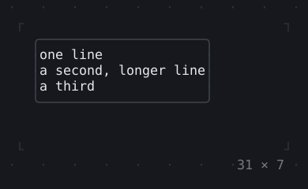
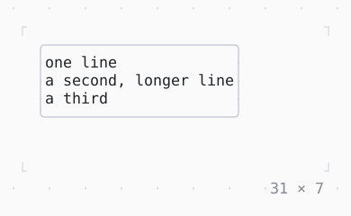

# AnimatedSize

As big as its child, running to the new size when the child grows or shrinks.

| Dark | Light |
| --- | --- |
|  |  |

## Code

The Dart that builds it, as the gallery's Code tab shows it with the
options as they start:

```dart
static const _lines = [
  'one line',
  'a second, longer line',
  'a third',
  'a fourth, the longest of them',
  'and a fifth',
];
static const _counts = [1, 3, 5];
var _i = 0;
late final Timer _timer;

@override
void initState() {
  super.initState();
  // more lines, or fewer, every 1.2 s
  _timer = Timer.periodic(
    const Duration(milliseconds: 1200),
    (_) => setState(() => _i = (_i + 1) % _counts.length),
  );
}

@override
void dispose() {
  _timer.cancel();
  super.dispose();
}

@override
Widget build(BuildContext context) {
  final theme = Theme.of(context);
  // the room it grows in: all five lines
  return SizedBox(
    width: 31,
    height: 7,
    child: Align(
      alignment: .topLeft,
      child: Box(
        border: .all(type: .rounded, style: theme.border),
        child: AnimatedSize(
          duration: const Duration(milliseconds: 600),
          curve: Curves.easeInOut,
          child: Column(
            mainAxisSize: .min,
            crossAxisAlignment: .start,
            children: [for (final line in _lines.take(_counts[_i])) Text(line)],
          ),
        ),
      ),
    ),
  );
}
```

## Options

What the gallery lets you change, and what each starts at:

| option | values | starts at |
| --- | --- | --- |
| lines | 1, 3, 5 | 1 |
| alignment | topLeft, center, bottomRight | topLeft |
| curve | linear, ease, easeIn, easeOut, easeInOut, fastOutSlowIn, decelerate, bounceOut, elasticOut | easeInOut |
| cycle | on, off | true |

## More

- API: [`AnimatedSize`](https://pub.dev/documentation/twk/latest/twk/AnimatedSize-class.html).
- Also in Animation: [Spinner](spinner.md), [ProgressBar](progressbar.md), [ProgressList](progresslist.md), [Skeleton, Skeletonize](skeleton-skeletonize.md), [AnimationController](animationcontroller.md), [AnimatedBuilder](animatedbuilder.md), [AnimatedAlign, AnimatedPadding](animatedalign-animatedpadding.md), [AnimatedPositioned](animatedpositioned.md), [AnimatedBox](animatedbox.md), [AnimatedOpacity, Opacity](animatedopacity-opacity.md), [AnimatedDefaultTextStyle](animateddefaulttextstyle.md), [TweenAnimationBuilder](tweenanimationbuilder.md), [AnimatedSwitcher](animatedswitcher.md), [Dissolve, FractionalTranslation](dissolve-fractionaltranslation.md), [Effect](effect.md).
- Live in the gallery:
  `dart run packages/gallery/bin/gallery.dart --route='#/animation/animatedsize'`.
- [Animation](../animation.md) · [All groups](../README.md)
