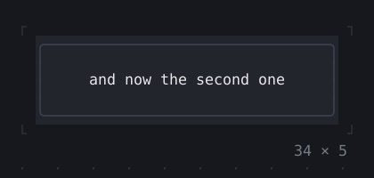
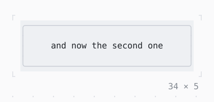

# AnimatedSwitcher

A child that gives way to another as the transition shows them: faded, slid or dissolved.

| Dark | Light |
| --- | --- |
|  |  |

## Code

The Dart that builds it, as the gallery's Code tab shows it with the
options as they start:

```dart
static const _children = [
  'the first child',
  'and now the second one',
  'a third',
];
var _i = 0;
late final Timer _timer;

@override
void initState() {
  super.initState();
  // the next child every 1.2 s
  _timer = Timer.periodic(
    const Duration(milliseconds: 1200),
    (_) => setState(() => _i = (_i + 1) % _children.length),
  );
}

@override
void dispose() {
  _timer.cancel();
  super.dispose();
}

@override
Widget build(BuildContext context) {
  final child = _children[_i];
  final theme = Theme.of(context);
  return SizedBox(
    width: 34,
    height: 5,
    child: Box(
      style: theme.surface,
      border: .all(type: .rounded, style: theme.border),
      child: AnimatedSwitcher(
        duration: const Duration(milliseconds: 600),
        child: SizedBox(
          key: ValueKey(child),
          width: 32,
          height: 3,
          child: Center(child: Text(child)),
        ),
      ),
    ),
  );
}
```

## Options

What the gallery lets you change, and what each starts at:

| option | values | starts at |
| --- | --- | --- |
| child | first, second, third | first |
| transition | fade, slide, slide right, slide up, slide down, dissolve | fade |
| cycle | on, off | true |

## More

- API: [`AnimatedSwitcher`](https://pub.dev/documentation/twk/latest/twk/AnimatedSwitcher-class.html).
- Also in Animation: [Spinner](spinner.md), [ProgressBar](progressbar.md), [ProgressList](progresslist.md), [Skeleton, Skeletonize](skeleton-skeletonize.md), [AnimationController](animationcontroller.md), [AnimatedBuilder](animatedbuilder.md), [AnimatedAlign, AnimatedPadding](animatedalign-animatedpadding.md), [AnimatedPositioned](animatedpositioned.md), [AnimatedBox](animatedbox.md), [AnimatedOpacity, Opacity](animatedopacity-opacity.md), [AnimatedDefaultTextStyle](animateddefaulttextstyle.md), [AnimatedSize](animatedsize.md), [TweenAnimationBuilder](tweenanimationbuilder.md), [Dissolve, FractionalTranslation](dissolve-fractionaltranslation.md), [Effect](effect.md).
- Live in the gallery:
  `dart run packages/gallery/bin/gallery.dart --route='#/animation/animatedswitcher'`.
- [Animation](../animation.md) · [All groups](../README.md)
