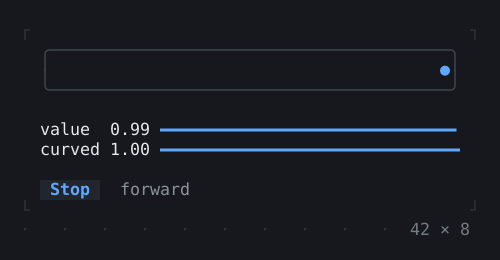
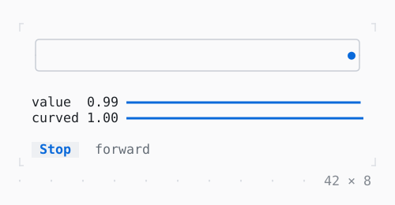

# AnimationController

An animation of the page's own: a controller from 0 to 1 and back, a frame at a time, through a curve and a tween.

| Dark | Light |
| --- | --- |
|  |  |

## Code

The Dart that builds it, as the gallery's Code tab shows it with the
options as they start:

```dart
final class _PulseState extends State<_Pulse>
    with TickerProviderStateMixin {
  late final _controller = AnimationController(
    vsync: this,
    duration: const Duration(seconds: 2),
  )..repeat(reverse: true);

  static const _across = IntTween(begin: 0, end: 39);

  @override
  void dispose() {
    _controller.dispose();
    super.dispose();
  }

  void _toggle() => setState(() {
    if (_controller.isAnimating) {
      _controller.stop();
    } else {
      _controller.repeat(reverse: true);
    }
  });

  @override
  Widget build(BuildContext context) {
    final theme = Theme.of(context);
    LineGauge gauge(double ratio, String label) => LineGauge(
      ratio: ratio,
      label: label,
      type: .heavy,
      filledStyle: theme.primary,
      unfilledStyle: theme.border,
    );
    return ListenableBuilder(
      listenable: _controller,
      builder: (context, _) {
        final value = _controller.value;
        final curved = Curves.easeInOut.transform(value);
        final x = _across.chain(Curves.easeInOut).evaluate(_controller);
        return SizedBox(
          width: 42,
          // the track as wide as the column: the dot runs across it
          child: Column(
            mainAxisSize: .min,
            crossAxisAlignment: .stretch,
            gap: 1,
            children: [
              Box(
                border: .all(type: .rounded, style: theme.border),
                child: Text(
                  '${' ' * x.clamp(0, 39)}●',
                  style: theme.primary,
                ),
              ),
              Column(
                mainAxisSize: .min,
                children: [
                  gauge(value, 'value  ${value.toStringAsFixed(2)}'),
                  gauge(curved, 'curved ${curved.toStringAsFixed(2)}'),
                ],
              ),
              Row(
                gap: 2,
                children: [
                  Button(
                    _controller.isAnimating ? 'Stop' : 'Run',
                    onPressed: _toggle,
                  ),
                  Text(_controller.status.name, style: theme.muted),
                ],
              ),
            ],
          ),
        );
      },
    );
  }
}
```

## Options

What the gallery lets you change, and what each starts at:

| option | values | starts at |
| --- | --- | --- |
| curve | linear, ease, easeIn, easeOut, easeInOut, fastOutSlowIn, decelerate, bounceOut, elasticOut | easeInOut |
| reverse | on, off | true |
| duration | 1 s, 2 s, 4 s | 2 s |

## More

- API: [`AnimationController`](https://pub.dev/documentation/twk/latest/twk/AnimationController-class.html).
- Also in Animation: [Spinner](spinner.md), [ProgressBar](progressbar.md), [ProgressList](progresslist.md), [Skeleton, Skeletonize](skeleton-skeletonize.md), [AnimatedBuilder](animatedbuilder.md), [AnimatedAlign, AnimatedPadding](animatedalign-animatedpadding.md), [AnimatedPositioned](animatedpositioned.md), [AnimatedBox](animatedbox.md), [AnimatedOpacity, Opacity](animatedopacity-opacity.md), [AnimatedDefaultTextStyle](animateddefaulttextstyle.md), [AnimatedSize](animatedsize.md), [TweenAnimationBuilder](tweenanimationbuilder.md), [AnimatedSwitcher](animatedswitcher.md), [Dissolve, FractionalTranslation](dissolve-fractionaltranslation.md), [Effect](effect.md).
- Live in the gallery:
  `dart run packages/gallery/bin/gallery.dart --route='#/animation/animationcontroller'`.
- [Animation](../animation.md) · [All groups](../README.md)
