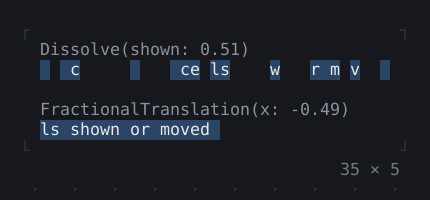
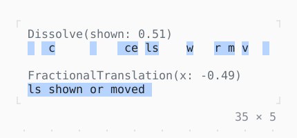

# Dissolve, FractionalTranslation

What the transitions are made of: a share of the cells of a child, and a child moved a share of its size.

| Dark | Light |
| --- | --- |
|  |  |

## Code

The Dart that builds it, as the gallery's Code tab shows it with the
options as they start:

```dart
final class _SharesState extends State<_Shares>
    with TickerProviderStateMixin {
  late final _controller = AnimationController(
    vsync: this,
    duration: const Duration(milliseconds: 2000),
    value: 0.5,
  )..repeat(reverse: true);

  @override
  void dispose() {
    _controller.dispose();
    super.dispose();
  }

  @override
  Widget build(BuildContext context) {
    final theme = Theme.of(context);
    final shown = Box(
      style: theme.selection,
      padding: const .x(1),
      child: const Text('a child, its cells shown or moved'),
    );
    return ListenableBuilder(
      listenable: _controller,
      builder: (context, _) {
        final share = _controller.value;
        return Column(
          mainAxisSize: .min,
          crossAxisAlignment: .start,
          children: [
            Text(
              'Dissolve(shown: ${share.toStringAsFixed(2)})',
              style: theme.muted,
            ),
            Dissolve(shown: share, child: shown),
            const SizedBox(height: 1),
            Text(
              'FractionalTranslation(x: ${(share - 1).toStringAsFixed(2)})',
              style: theme.muted,
            ),
            FractionalTranslation(x: share - 1, child: shown),
          ],
        );
      },
    );
  }
}
```

## Options

What the gallery lets you change, and what each starts at:

| option | values | starts at |
| --- | --- | --- |
| share | 0, ¼, ½, ¾, 1 | ½ |
| run | on, off | true |
| inverse | on, off | false |

## More

- API: [`Dissolve`](https://pub.dev/documentation/twk/latest/twk/Dissolve-class.html), [`FractionalTranslation`](https://pub.dev/documentation/twk/latest/twk/FractionalTranslation-class.html).
- Also in Animation: [Spinner](spinner.md), [ProgressBar](progressbar.md), [ProgressList](progresslist.md), [Skeleton, Skeletonize](skeleton-skeletonize.md), [AnimationController](animationcontroller.md), [AnimatedBuilder](animatedbuilder.md), [AnimatedAlign, AnimatedPadding](animatedalign-animatedpadding.md), [AnimatedPositioned](animatedpositioned.md), [AnimatedBox](animatedbox.md), [AnimatedOpacity, Opacity](animatedopacity-opacity.md), [AnimatedDefaultTextStyle](animateddefaulttextstyle.md), [AnimatedSize](animatedsize.md), [TweenAnimationBuilder](tweenanimationbuilder.md), [AnimatedSwitcher](animatedswitcher.md), [Effect](effect.md).
- Live in the gallery:
  `dart run packages/gallery/bin/gallery.dart --route='#/animation/dissolve-fractionaltranslation'`.
- [Animation](../animation.md) · [All groups](../README.md)
