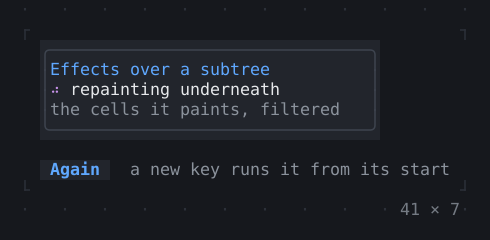
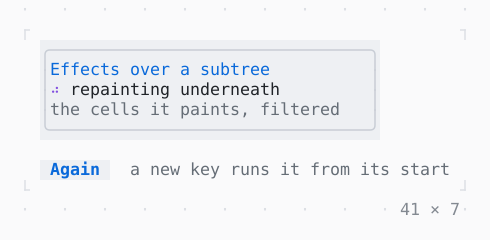

# Effect

A child shown through an effect over its cells, run on the app's clock: recolored, swept, dissolved, typed or glitched in, while the child repaints underneath.

| Dark | Light |
| --- | --- |
|  |  |

## Code

The Dart that builds it, as the gallery's Code tab shows it with the
options as they start:

```dart
const _duration = Duration(milliseconds: 600);

/// Each color as its opposite: the negative of a photograph.
static Color _invert(Color c) =>
    Color.rgb(255 - c.r, 255 - c.g, 255 - c.b);

static const _effects = <CellEffect>[
  CellEffect.sweep(duration: _duration),
  CellEffect.dissolve(duration: _duration),
  CellEffect.typewriter(duration: _duration),
  CellEffect.glitch(duration: _duration),
  CellEffect.dim(duration: _duration),
  CellEffect.desaturate(duration: _duration),
  CellEffect.tint(Color.blue, duration: _duration),
  CellEffect.scanlines(),
  CellEffect.grade(_invert, duration: _duration),
  CellEffect.sequence([
    CellEffect.sweep(from: .topCenter, duration: _duration),
    CellEffect.glitch(duration: _duration),
  ]),
];
var _i = 0;
var _runs = 0;
late final Timer _timer;

@override
void initState() {
  super.initState();
  // the next effect every 1.2 s, run from its start
  _timer = Timer.periodic(
    const Duration(milliseconds: 1200),
    (_) => setState(() => _i = (_i + 1) % _effects.length),
  );
}

@override
void dispose() {
  _timer.cancel();
  super.dispose();
}

@override
Widget build(BuildContext context) {
  final theme = Theme.of(context);
  return Column(
    mainAxisSize: .min,
    crossAxisAlignment: .start,
    gap: 1,
    children: [
      Box(
        style: theme.surface,
        border: .all(type: .rounded, style: theme.border),
        child: Effect(
          key: ValueKey(_runs),
          effect: _effects[_i],
          child: SizedBox(
            width: 32,
            height: 3,
            child: Column(
              crossAxisAlignment: .start,
              children: [
                Text('Effects over a subtree', style: theme.primary),
                Row(
                  gap: 1,
                  children: [
                    Spinner(style: theme.accent),
                    const Text('repainting underneath'),
                  ],
                ),
                Text('the cells it paints, filtered', style: theme.muted),
              ],
            ),
          ),
        ),
      ),
      Row(
        mainAxisSize: .min,
        gap: 2,
        children: [
          Button('Again', onPressed: () => setState(() => _runs++)),
          Text('a new key runs it from its start', style: theme.muted),
        ],
      ),
    ],
  );
}
```

## Options

What the gallery lets you change, and what each starts at:

| option | values | starts at |
| --- | --- | --- |
| effect | sweep, dissolve, typewriter, glitch, dim, desaturate, tint, scanlines, grade, sweep down, glitch | sweep |
| cycle | on, off | true |

## More

- API: [`Effect`](https://pub.dev/documentation/twk/latest/twk/Effect-class.html).
- Also in Animation: [Spinner](spinner.md), [ProgressBar](progressbar.md), [ProgressList](progresslist.md), [Skeleton, Skeletonize](skeleton-skeletonize.md), [AnimationController](animationcontroller.md), [AnimatedBuilder](animatedbuilder.md), [AnimatedAlign, AnimatedPadding](animatedalign-animatedpadding.md), [AnimatedPositioned](animatedpositioned.md), [AnimatedBox](animatedbox.md), [AnimatedOpacity, Opacity](animatedopacity-opacity.md), [AnimatedDefaultTextStyle](animateddefaulttextstyle.md), [AnimatedSize](animatedsize.md), [TweenAnimationBuilder](tweenanimationbuilder.md), [AnimatedSwitcher](animatedswitcher.md), [Dissolve, FractionalTranslation](dissolve-fractionaltranslation.md).
- Live in the gallery:
  `dart run packages/gallery/bin/gallery.dart --route='#/animation/effect'`.
- [Animation](../animation.md) · [All groups](../README.md)
