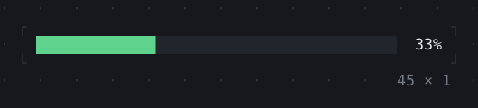
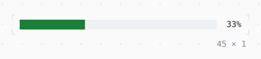

# ProgressBar

A bar filled as far as its value, in eighths of a cell; a block going to and fro while the value is not known.

| Dark | Light |
| --- | --- |
|  |  |

## Code

The Dart that builds it, as the gallery's Code tab shows it with the
options as they start:

```dart
final theme = Theme.of(context);
return Row(
  mainAxisSize: .min,
  gap: 1,
  children: [
    SizedBox(
      width: 40,
      child: ProgressBar(
        value: 0.33,
        style: theme.success.merge(.new(bg: theme.surface.bg)),
      ),
    ),
    const Text(' 33%'),
  ],
);
```

## Options

What the gallery lets you change, and what each starts at:

| option | values | starts at |
| --- | --- | --- |
| value known | on, off | true |
| value | 0% to 100% | 33 |
| style | primary, accent, success, warning, info | success |

## More

- API: [`ProgressBar`](https://pub.dev/documentation/twk/latest/twk/ProgressBar-class.html).
- Also in Animation: [Spinner](spinner.md), [ProgressList](progresslist.md), [Skeleton, Skeletonize](skeleton-skeletonize.md), [AnimationController](animationcontroller.md), [AnimatedBuilder](animatedbuilder.md), [AnimatedAlign, AnimatedPadding](animatedalign-animatedpadding.md), [AnimatedPositioned](animatedpositioned.md), [AnimatedBox](animatedbox.md), [AnimatedOpacity, Opacity](animatedopacity-opacity.md), [AnimatedDefaultTextStyle](animateddefaulttextstyle.md), [AnimatedSize](animatedsize.md), [TweenAnimationBuilder](tweenanimationbuilder.md), [AnimatedSwitcher](animatedswitcher.md), [Dissolve, FractionalTranslation](dissolve-fractionaltranslation.md), [Effect](effect.md).
- Live in the gallery:
  `dart run packages/gallery/bin/gallery.dart --route='#/animation/progressbar'`.
- [Animation](../animation.md) · [All groups](../README.md)
