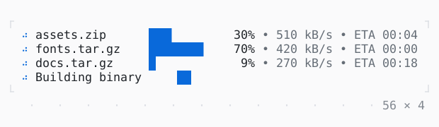

# ProgressList

Many tasks at once, a row each: its mark, a bar, how much is done, its rate and the time it has left, from a ProgressTracker the work counts on.

| Dark | Light |
| --- | --- |
|  |  |

## Code

The Dart that builds it, as the gallery's Code tab shows it with the
options as they start:

```dart
/// The downloads: a name, a size in bytes, and the bytes a tick brings.
static const _downloads = [
  ('assets.zip', 3400000, 170000),
  ('fonts.tar.gz', 1200000, 140000),
  ('docs.tar.gz', 5600000, 90000),
];

/// On the app's clock, which a test's fake clock moves too.
late final _tracker = ProgressTracker(
  clock: AppBinding.of(context).twkApp.clock,
);
late final Timer _timer;
var _ticks = 0;

@override
void initState() {
  super.initState();
  _start();
  // the bytes that came in, every 300 ms
  _timer = Timer.periodic(
    const Duration(milliseconds: 300),
    (_) => _tick(),
  );
}

@override
void dispose() {
  _timer.cancel();
  _tracker.dispose();
  super.dispose();
}

/// The downloads and the build, from the start.
void _start() {
  for (final task in [..._tracker.tasks]) {
    _tracker.remove(task);
  }
  for (final (name, size, _) in _downloads) {
    _tracker.add(name, total: size, unit: .bytes).start();
  }
  _tracker.add('Building binary').start();
}

void _tick() {
  // and all again, after 12 s
  if (++_ticks % 40 == 0) {
    return _start();
  }
  final tasks = _tracker.tasks;
  for (final (i, (_, _, bytes)) in _downloads.indexed) {
    final task = tasks[i]..advance(bytes);
    if (task.completed >= task.total!) {
      task.done();
    }
  }
  if (_ticks % 40 == 12) {
    tasks[2].fail('connection reset');
  }
  if (_ticks % 40 == 30) {
    tasks[3].done();
  }
}

@override
Widget build(BuildContext context) => SizedBox(
  width: 60,
  child: ProgressList(
    tracker: _tracker,
  ),
);
```

## Options

What the gallery lets you change, and what each starts at:

| option | values | starts at |
| --- | --- | --- |
| columns | default, count, elapsed | default |
| bar | blocks, line | blocks |
| spinner | dots, line, arc | dots |
| hide finished | on, off | false |
| at most | all, 2 | all |

## More

- API: [`ProgressList`](https://pub.dev/documentation/twk/latest/twk/ProgressList-class.html).
- Also in Animation: [Spinner](spinner.md), [ProgressBar](progressbar.md), [Skeleton, Skeletonize](skeleton-skeletonize.md), [AnimationController](animationcontroller.md), [AnimatedBuilder](animatedbuilder.md), [AnimatedAlign, AnimatedPadding](animatedalign-animatedpadding.md), [AnimatedPositioned](animatedpositioned.md), [AnimatedBox](animatedbox.md), [AnimatedOpacity, Opacity](animatedopacity-opacity.md), [AnimatedDefaultTextStyle](animateddefaulttextstyle.md), [AnimatedSize](animatedsize.md), [TweenAnimationBuilder](tweenanimationbuilder.md), [AnimatedSwitcher](animatedswitcher.md), [Dissolve, FractionalTranslation](dissolve-fractionaltranslation.md), [Effect](effect.md).
- Live in the gallery:
  `dart run packages/gallery/bin/gallery.dart --route='#/animation/progresslist'`.
- [Animation](../animation.md) · [All groups](../README.md)
