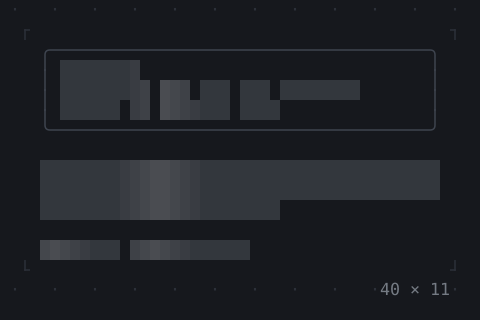
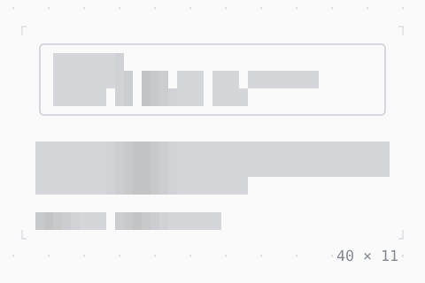

# Skeleton, Skeletonize

Placeholders while content loads: blocks where it will be, or a subtree drawn as blocks in the layout it has, a shimmer sweeping over them as a SkeletonTheme says.

| Dark | Light |
| --- | --- |
|  |  |

## Code

The Dart that builds it, as the gallery's Code tab shows it with the
options as they start:

```dart
final theme = Theme.of(context);
return SkeletonTheme(
  child: Column(
    mainAxisSize: .min,
    crossAxisAlignment: .start,
    gap: 1,
    children: [
      SizedBox(
        width: 40,
        child: Box(
          border: .all(type: .rounded, style: theme.border),
          padding: const .x(1),
          // laid out as it is, drawn as blocks while it loads
          child: Skeletonize(
            enabled: true,
            child: Column(
              mainAxisSize: .min,
              crossAxisAlignment: .start,
              children: [
                Text('user@twk', style: theme.primary),
                const Text('Maintains twk and its gallery.'),
                Text('Joined 19 October 2026', style: theme.muted),
              ],
            ),
          ),
        ),
      ),
      // blocks of their own: three lines, and two words
      const SizedBox(width: 40, child: Skeleton.text(lines: 3)),
      const Row(
        mainAxisSize: .min,
        gap: 1,
        children: [Skeleton(width: 8), Skeleton(width: 12)],
      ),
    ],
  ),
);
```

## Options

What the gallery lets you change, and what each starts at:

| option | values | starts at |
| --- | --- | --- |
| loading | on, off | true |
| shimmer | on, off | true |
| glyph | ░, ▒, ▓ | ░ |
| band | 8, 4, 16 | 8 |

## More

- API: [`Skeleton`](https://pub.dev/documentation/twk/latest/twk/Skeleton-class.html), [`Skeletonize`](https://pub.dev/documentation/twk/latest/twk/Skeletonize-class.html).
- Also in Animation: [Spinner](spinner.md), [ProgressBar](progressbar.md), [ProgressList](progresslist.md), [AnimationController](animationcontroller.md), [AnimatedBuilder](animatedbuilder.md), [AnimatedAlign, AnimatedPadding](animatedalign-animatedpadding.md), [AnimatedPositioned](animatedpositioned.md), [AnimatedBox](animatedbox.md), [AnimatedOpacity, Opacity](animatedopacity-opacity.md), [AnimatedDefaultTextStyle](animateddefaulttextstyle.md), [AnimatedSize](animatedsize.md), [TweenAnimationBuilder](tweenanimationbuilder.md), [AnimatedSwitcher](animatedswitcher.md), [Dissolve, FractionalTranslation](dissolve-fractionaltranslation.md), [Effect](effect.md).
- Live in the gallery:
  `dart run packages/gallery/bin/gallery.dart --route='#/animation/skeleton-skeletonize'`.
- [Animation](../animation.md) · [All groups](../README.md)
