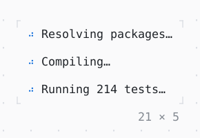

# Spinner

Frames shown in turn while something goes on; spinners of the same frames step together.

| Dark | Light |
| --- | --- |
|  |  |

## Code

The Dart that builds it, as the gallery's Code tab shows it with the
options as they start:

```dart
final theme = Theme.of(context);
const tasks = ['Resolving packages…', 'Compiling…', 'Running 214 tests…'];
return Column(
  mainAxisSize: .min,
  crossAxisAlignment: .start,
  gap: 1,
  children: [
    for (final task in tasks)
      Row(
        mainAxisSize: .min,
        gap: 1,
        children: [
          Spinner(style: theme.primary),
          Text(task),
        ],
      ),
  ],
);
```

## Options

What the gallery lets you change, and what each starts at:

| option | values | starts at |
| --- | --- | --- |
| frames | dots, line, arc | dots |
| style | primary, accent, success, warning, info | primary |

## More

- API: [`Spinner`](https://pub.dev/documentation/twk/latest/twk/Spinner-class.html).
- Also in Animation: [ProgressBar](progressbar.md), [ProgressList](progresslist.md), [Skeleton, Skeletonize](skeleton-skeletonize.md), [AnimationController](animationcontroller.md), [AnimatedBuilder](animatedbuilder.md), [AnimatedAlign, AnimatedPadding](animatedalign-animatedpadding.md), [AnimatedPositioned](animatedpositioned.md), [AnimatedBox](animatedbox.md), [AnimatedOpacity, Opacity](animatedopacity-opacity.md), [AnimatedDefaultTextStyle](animateddefaulttextstyle.md), [AnimatedSize](animatedsize.md), [TweenAnimationBuilder](tweenanimationbuilder.md), [AnimatedSwitcher](animatedswitcher.md), [Dissolve, FractionalTranslation](dissolve-fractionaltranslation.md), [Effect](effect.md).
- Live in the gallery:
  `dart run packages/gallery/bin/gallery.dart --route='#/animation/spinner'`.
- [Animation](../animation.md) · [All groups](../README.md)
