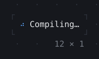
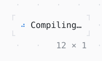

# TickerMode

Whether the animations below tick: off, they ask for no frames and stand still, and go on when it is on again; Offstage and Visibility turn it off for what they hide.

| Dark | Light |
| --- | --- |
|  |  |

## Code

The Dart that builds it, as the gallery's Code tab shows it with the
options as they start:

```dart
final theme = Theme.of(context);
return TickerMode(
  enabled: true,
  child: Row(
    mainAxisSize: .min,
    gap: 1,
    children: [
      Spinner(style: theme.primary),
      const Text('Compiling…'),
    ],
  ),
);
```

## Options

What the gallery lets you change, and what each starts at:

| option | values | starts at |
| --- | --- | --- |
| enabled | on, off | true |

## More

- API: [`TickerMode`](https://pub.dev/documentation/twk/latest/twk/TickerMode-class.html).
- Also in Animation: [Spinner](spinner.md), [ProgressBar](progressbar.md), [ProgressList](progresslist.md), [Skeleton, Skeletonize](skeleton-skeletonize.md), [AnimationController](animationcontroller.md), [AnimatedBuilder](animatedbuilder.md), [AnimatedAlign, AnimatedPadding](animatedalign-animatedpadding.md), [AnimatedPositioned](animatedpositioned.md), [AnimatedBox](animatedbox.md), [AnimatedOpacity, Opacity](animatedopacity-opacity.md), [AnimatedDefaultTextStyle](animateddefaulttextstyle.md), [AnimatedSize](animatedsize.md), [TweenAnimationBuilder](tweenanimationbuilder.md), [AnimatedSwitcher](animatedswitcher.md), [Dissolve, FractionalTranslation](dissolve-fractionaltranslation.md), [Effect](effect.md).
- Live in the gallery:
  `dart run packages/gallery/bin/gallery.dart --route='#/animation/tickermode'`.
- [Animation](../animation.md) · [All groups](../README.md)
