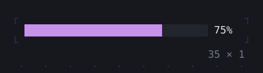
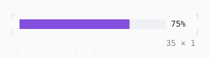

# TweenAnimationBuilder

Builds with a value that runs to the one it is given, through the tweens it makes.

| Dark | Light |
| --- | --- |
|  |  |

## Code

The Dart that builds it, as the gallery's Code tab shows it with the
options as they start:

```dart
static const _values = [0.0, 0.25, 0.5, 0.75, 1.0];
var _i = 2;
late final Timer _timer;

@override
void initState() {
  super.initState();
  // the next value every 1.2 s
  _timer = Timer.periodic(
    const Duration(milliseconds: 1200),
    (_) => setState(() => _i = (_i + 1) % _values.length),
  );
}

@override
void dispose() {
  _timer.cancel();
  super.dispose();
}

@override
Widget build(BuildContext context) => TweenAnimationBuilder<double>(
  value: _values[_i],
  from: 0,
  tween: Tween.new,
  duration: const Duration(milliseconds: 600),
  curve: Curves.easeInOut,
  builder: (context, value, _) {
    final theme = Theme.of(context);
    return Row(
      mainAxisSize: .min,
      gap: 1,
      children: [
        SizedBox(
          width: 30,
          child: ProgressBar(
            value: value,
            style: theme.accent.merge(.new(bg: theme.surface.bg)),
          ),
        ),
        // as wide as 100%
        SizedBox(width: 4, child: Text('${(value * 100).round()}%')),
      ],
    );
  },
);
```

## Options

What the gallery lets you change, and what each starts at:

| option | values | starts at |
| --- | --- | --- |
| value | 0, ¼, ½, ¾, 1 | ½ |
| curve | linear, ease, easeIn, easeOut, easeInOut, fastOutSlowIn, decelerate, bounceOut, elasticOut | easeInOut |
| cycle | on, off | true |

## More

- API: [`TweenAnimationBuilder`](https://pub.dev/documentation/twk/latest/twk/TweenAnimationBuilder-class.html).
- Also in Animation: [Spinner](spinner.md), [ProgressBar](progressbar.md), [ProgressList](progresslist.md), [Skeleton, Skeletonize](skeleton-skeletonize.md), [AnimationController](animationcontroller.md), [AnimatedBuilder](animatedbuilder.md), [AnimatedAlign, AnimatedPadding](animatedalign-animatedpadding.md), [AnimatedPositioned](animatedpositioned.md), [AnimatedBox](animatedbox.md), [AnimatedOpacity, Opacity](animatedopacity-opacity.md), [AnimatedDefaultTextStyle](animateddefaulttextstyle.md), [AnimatedSize](animatedsize.md), [AnimatedSwitcher](animatedswitcher.md), [Dissolve, FractionalTranslation](dissolve-fractionaltranslation.md), [Effect](effect.md).
- Live in the gallery:
  `dart run packages/gallery/bin/gallery.dart --route='#/animation/tweenanimationbuilder'`.
- [Animation](../animation.md) · [All groups](../README.md)
