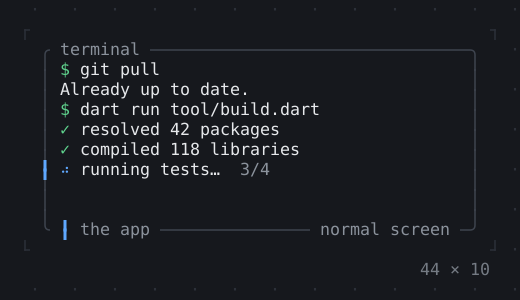
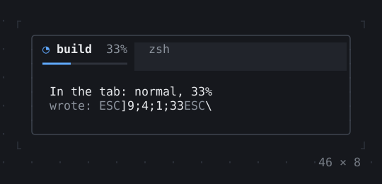
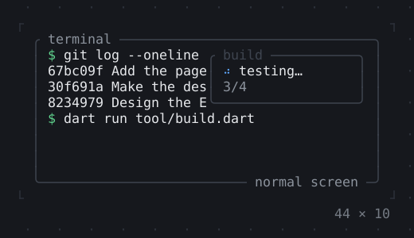
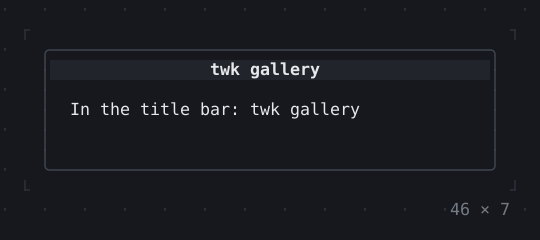
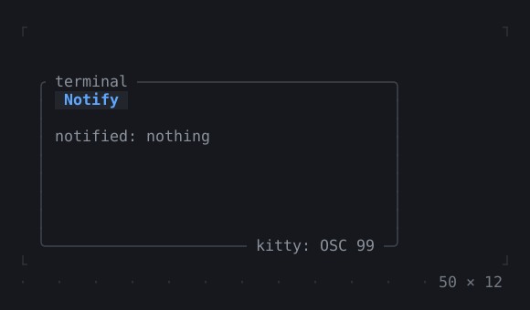

# App

The app around it all: the screen modes, a fixed viewport, output kept in the scrollback, the window title, notifications and a command-line tool’s console.

[All groups](README.md)

| | |
| --- | --- |
|  **[InputListener](app/inputlistener.md)** The input no widget took: keys nothing is bound to, the mouse where no Listener is, pastes, focus and resizes. |  **[ErrorWidget](app/errorwidget.md)** An error shown in place of what failed to build, as the app does by itself. |
|  **[Static](app/static.md)** Output that is finished once shown: in place here; in the inline mode above the app, in the terminal's history. |  **[TerminalProgress](app/terminalprogress.md)** The program's progress in the terminal's tab or taskbar, where the terminal shows one (Ghostty, kitty, Windows Terminal, ConEmu). |
|  **[Viewport](app/viewport.md)** The app in a fixed rectangle of the screen (Viewport.fixed): nothing outside it is written, so what the terminal showed around it stays. |  **[Window title](app/window-title.md)** The title of the terminal's window or tab while the app runs; the user's own comes back when it ends. |
|  **[Notifications](app/notifications.md)** A desktop notification of a title and a body, where the terminal shows one (OSC 9, 777 or 99); nothing where it does not. |  **[Cli](app/cli.md)** A command-line tool's console (twk_cli) as it runs: questions that leave their answer as a line, a spinner, tasks with bars, a traceback. In `twk_cli`. |

