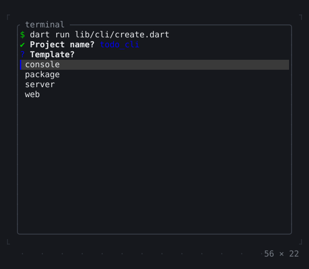
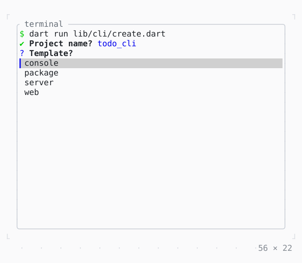

# Cli

A command-line tool's console (twk's cli.dart) as it runs: questions that leave their answer as a line, a spinner, tasks with bars, a traceback.

| Dark | Light |
| --- | --- |
|  |  |

## Code

The Dart that builds it, as the gallery's Code tab shows it with the
options as they start:

```dart
// Asks what a new app is to be: its name, a template, its features and a
// last yes or no. At a terminal each question is a widget until it is
// answered, then a line: `✔ Template? server`.
import 'package:twk/cli.dart';
import 'package:twk/twk.dart';

Future<void> main(List<String> args) => Cli.runWithArgs(args, create);

Future<void> create(Cli cli, List<String> rest) async {
  final name = await cli.prompt(
    'Project name?',
    defaultValue: 'my_app',
    validate: (name) => RegExp(r'^[a-z][a-z0-9_]*$').hasMatch(name)
        ? null
        : 'lowercase letters, digits and _',
  );
  final template = await cli.chooseOne(
    'Template?',
    choices: ['console', 'package', 'server', 'web'],
  );
  final features = await cli.chooseAny(
    'Features?',
    choices: ['Linter', 'Docker', 'Tests', 'CI'],
    defaultValues: ['Linter'],
  );
  if (!await cli.confirm('Create $name?')) {
    cli.info('Nothing created.');
    return;
  }
  cli.success([
    'Created '.bold,
    name,
    ' from ',
    template.italic,
    ' with ${features.join(', ')}',
  ]);
}

```

## Options

What the gallery lets you change, and what each starts at:

| option | values | starts at |
| --- | --- | --- |
| program | create, install, check | create |

## More

- Also in App: [InputListener](inputlistener.md), [ErrorWidget](errorwidget.md), [Static](static.md), [TerminalProgress](terminalprogress.md), [Viewport](viewport.md), [Window title](window-title.md), [Notifications](notifications.md).
- Live in the gallery:
  `dart run packages/gallery/bin/gallery.dart --route='#/app/cli'`.
- [App](../app.md) · [All groups](../README.md)
