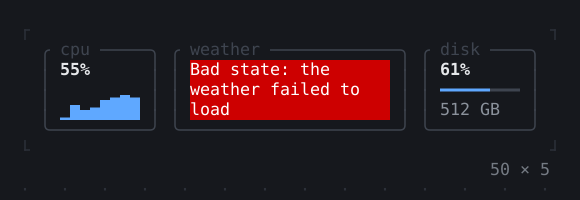
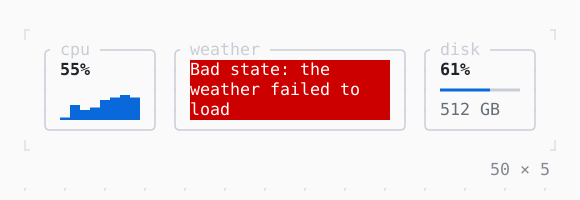

# ErrorWidget

An error shown in place of what failed to build, as the app does by itself.

| Dark | Light |
| --- | --- |
|  |  |

## Code

The Dart that builds it, as the gallery's Code tab shows it with the
options as they start:

```dart
/// The weather card's content.
final class _Weather extends StatelessWidget {
  const _Weather();

  // throws: the app shows an ErrorWidget in its place, as
  // ErrorWidget(StateError('the weather failed to load')) would,
  // and logs the error with the path of the widget at LogLevel.error
  @override
  Widget build(BuildContext context) =>
      throw StateError('the weather failed to load');
}

/// The cpu's load at step [i]: a wave and noise, from 4 to 96.
static double _loadAt(int i) {
  final s = sin(i * 78.233 + 1.7) * 43758.5453;
  final noise = s - s.floorToDouble();
  return (40 + 16 * sin(i / 2.3) + 34 * (noise - 0.5))
      .clamp(4, 96)
      .roundToDouble();
}

// the last 8 loads, a new one every 600 ms
var _step = 0;
var _load = [for (var i = -7; i <= 0; i++) _loadAt(i)];
late final Timer _timer;

@override
void initState() {
  super.initState();
  _timer = Timer.periodic(
    const Duration(milliseconds: 600),
    (_) => setState(() => _load = [..._load.skip(1), _loadAt(++_step)]),
  );
}

@override
void dispose() {
  _timer.cancel();
  super.dispose();
}

@override
Widget build(BuildContext context) {
  final theme = Theme.of(context);
  const bold = Style(attrs: Attr.bold);
  Widget card(String title, Widget child, {int flex = 1}) => Expanded(
    flex: flex,
    child: Box(
      border: .all(type: .rounded, style: theme.border),
      titles: [BorderTitle(' $title ')],
      padding: const .x(1),
      child: child,
    ),
  );
  return SizedBox(
    width: 50,
    height: 5,
    child: Row(
      crossAxisAlignment: .stretch,
      gap: 1,
      children: [
        card(
          'cpu',
          Column(
            crossAxisAlignment: .stretch,
            children: [
              Text('${_load.last.round()}%', style: bold),
              Expanded(
                child: Sparkline(data: _load, max: 100, style: theme.primary),
              ),
            ],
          ),
        ),
        card('weather', const _Weather(), flex: 2),
        card(
          'disk',
          Column(
            crossAxisAlignment: .stretch,
            children: [
              const Text('61%', style: bold),
              LineGauge(
                ratio: 0.61,
                label: '',
                type: .heavy,
                filledStyle: theme.primary,
                unfilledStyle: theme.border,
              ),
              Text('512 GB', style: theme.muted),
            ],
          ),
        ),
      ],
    ),
  );
}
```

## Options

What the gallery lets you change, and what each starts at:

| option | values | starts at |
| --- | --- | --- |
| weather fails | on, off | true |
| what it throws | StateError, FormatException, Exception | StateError |

## More

- API: [`ErrorWidget`](https://pub.dev/documentation/twk/latest/twk/ErrorWidget-class.html).
- Also in App: [InputListener](inputlistener.md), [Static](static.md), [TerminalProgress](terminalprogress.md), [Viewport](viewport.md), [Window title](window-title.md), [Notifications](notifications.md), [Cli](cli.md).
- Live in the gallery:
  `dart run packages/gallery/bin/gallery.dart --route='#/app/errorwidget'`.
- [App](../app.md) · [All groups](../README.md)
