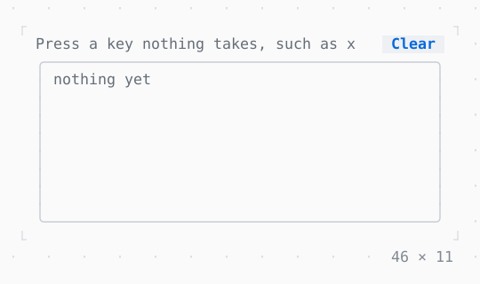

# InputListener

The input no widget took: keys nothing is bound to, the mouse where no Listener is, pastes, focus and resizes.

| Dark | Light |
| --- | --- |
|  |  |

## Code

The Dart that builds it, as the gallery's Code tab shows it with the
options as they start:

```dart
final _events = <(String, String)>[];

/// A key as twk names it: ctrl+x, shift+tab, pageDown, space.
String _name(KeyEvent key) => [
  if (key.ctrl) 'ctrl',
  if (key.alt) 'alt',
  if (key.shift && key.code != KeyCode.char) 'shift',
  switch (key) {
    KeyEvent(code: KeyCode.char, char: ' ') => 'space',
    KeyEvent(code: KeyCode.char, :final char) => char,
    KeyEvent(:final code) => code.name,
  },
].join('+');

bool _onEvent(InputEvent event) {
  final heard = switch (event) {
    KeyEvent(kind: KeyKind.release) => null,
    final KeyEvent key => ('key', _name(key)),
    MouseEvent(:final kind, :final x, :final y) => (
      'mouse',
      '${kind.name} $x,$y',
    ),
    PasteEvent(:final text) => ('paste', 'of ${text.length} characters'),
    FocusEvent(:final focused) => ('focus', focused ? 'in' : 'out'),
    ResizeEvent(:final width, :final height) => (
      'resize',
      'to $width×$height',
    ),
    _ => null,
  };
  if (heard != null) {
    setState(() {
      _events.add(heard);
      if (_events.length > 8) {
        _events.removeAt(0);
      }
    });
  }
  // not taken: the listeners mounted before this one get it too
  return false;
}

@override
Widget build(BuildContext context) {
  final theme = Theme.of(context);
  final styles = {
    'key': theme.info,
    'mouse': theme.accent,
    'paste': theme.success,
    'focus': theme.warning,
    'resize': theme.primary,
  };
  return InputListener(
    onEvent: _onEvent,
    child: SizedBox(
      width: 46,
      child: Column(
        mainAxisSize: .min,
        crossAxisAlignment: .stretch,
        children: [
          Row(
            children: [
              Expanded(
                child: Text(
                  'Press a key nothing takes, such as x',
                  style: theme.muted,
                ),
              ),
              // takes Enter and Space while it has the focus, and its
              // clicks: none of them reach the listener
              Button('Clear', onPressed: () => setState(_events.clear)),
            ],
          ),
          Box(
            border: .all(type: .rounded, style: theme.border),
            padding: const .x(1),
            child: SizedBox(
              height: 8,
              child: Column(
                crossAxisAlignment: .start,
                children: [
                  if (_events.isEmpty)
                    Text('nothing yet', style: theme.muted),
                  for (final (kind, what) in _events)
                    Text.rich([
                      Span(kind.padRight(7), styles[kind]!),
                      Span(what),
                    ]),
                ],
              ),
            ),
          ),
        ],
      ),
    ),
  );
}
```

## More

- API: [`InputListener`](https://pub.dev/documentation/twk/latest/twk/InputListener-class.html).
- Also in App: [ErrorWidget](errorwidget.md), [Static](static.md), [TerminalProgress](terminalprogress.md), [Viewport](viewport.md), [Window title](window-title.md), [Notifications](notifications.md), [Cli](cli.md).
- Live in the gallery:
  `dart run packages/gallery/bin/gallery.dart --route='#/app/inputlistener'`.
- [App](../app.md) · [All groups](../README.md)
