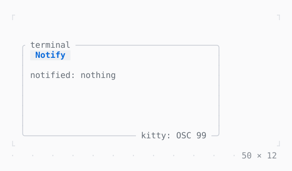

# Notifications

A desktop notification of a title and a body, where the terminal shows one (OSC 9, 777 or 99); nothing where it does not.

| Dark | Light |
| --- | --- |
|  |  |

## Code

The Dart that builds it, as the gallery's Code tab shows it with the
options as they start:

```dart
var _notified = 0;

// shown where the terminal is known to show one (OSC 9, 777 or 99,
// TerminalInfo.notifications); nothing elsewhere
void _notify() {
  AppBinding.of(context).notify('Build finished', 'ran 214 tests in 3.2 s');
  setState(() => _notified++);
}

@override
Widget build(BuildContext context) {
  final theme = Theme.of(context);
  return Column(
    crossAxisAlignment: .start,
    gap: 1,
    children: [
      Button('Notify', onPressed: _notify),
      Text.rich([
        Span('notified: ', theme.muted),
        if (_notified == 0)
          Span('nothing', theme.muted)
        else
          Span('$_notified'),
      ]),
    ],
  );
}
```

## Options

What the gallery lets you change, and what each starts at:

| option | values | starts at |
| --- | --- | --- |
| terminal | kitty, Ghostty, iTerm2, xterm | kitty |

## More

- Also in App: [InputListener](inputlistener.md), [ErrorWidget](errorwidget.md), [Static](static.md), [TerminalProgress](terminalprogress.md), [Viewport](viewport.md), [Window title](window-title.md), [Cli](cli.md).
- Live in the gallery:
  `dart run packages/gallery/bin/gallery.dart --route='#/app/notifications'`.
- [App](../app.md) · [All groups](../README.md)
