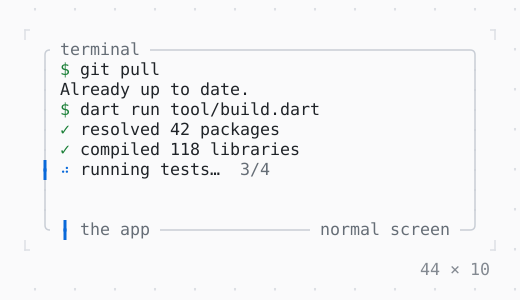

# Static

Output that is finished once shown: in place here; in the inline mode above the app, in the terminal's history.

| Dark | Light |
| --- | --- |
|  |  |

## Code

The Dart that builds it, as the gallery's Code tab shows it with the
options as they start:

```dart
import 'dart:async';

import 'package:twk/twk.dart';

void main() => runApp(const Build(), mode: ScreenMode.inline);

final class Build extends StatefulWidget {
  const Build({super.key});

  @override
  State<Build> createState() => _BuildState();
}

final class _BuildState extends State<Build> {
  static const _doing = [
    'resolving packages',
    'compiling',
    'running tests',
    'writing build/app.js',
  ];
  static const _did = [
    'resolved 42 packages',
    'compiled 118 libraries',
    'ran 214 tests',
    'wrote build/app.js',
  ];

  // the steps done, each shown once: finished output
  final _done = <String>[];
  Timer? _timer;

  @override
  void initState() {
    super.initState();
    _timer = Timer.periodic(const Duration(milliseconds: 800), (_) => _step());
  }

  void _step() {
    if (_done.length == _did.length) {
      // a tick after the last item: the frame that built it wrote it
      _timer?.cancel();
      AppBinding.of(context).quit();
      return;
    }
    setState(() => _done.add(_did[_done.length]));
  }

  @override
  void dispose() {
    _timer?.cancel();
    super.dispose();
  }

  @override
  Widget build(BuildContext context) {
    final theme = Theme.of(context);
    return Column(
      crossAxisAlignment: .start,
      children: [
        // each item goes to the terminal's history, above the region
        Static<String>(
          items: _done,
          builder: (context, step) =>
              Text.rich([Span('✓ ', theme.success), Span(step)]),
        ),
        if (_done.length < _did.length)
          Row(
            gap: 1,
            children: [
              const Spinner(),
              Text('${_doing[_done.length]}…'),
              Text(' ${_done.length + 1}/${_did.length}', style: theme.muted),
            ],
          ),
      ],
    );
  }
}
```

## Options

What the gallery lets you change, and what each starts at:

| option | values | starts at |
| --- | --- | --- |
| mode | inline, fullscreen | inline |

## More

- API: [`Static`](https://pub.dev/documentation/twk/latest/twk/Static-class.html).
- Also in App: [InputListener](inputlistener.md), [ErrorWidget](errorwidget.md), [TerminalProgress](terminalprogress.md), [Viewport](viewport.md), [Window title](window-title.md), [Notifications](notifications.md), [Cli](cli.md).
- Live in the gallery:
  `dart run packages/gallery/bin/gallery.dart --route='#/app/static'`.
- [App](../app.md) · [All groups](../README.md)
