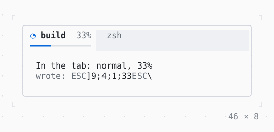

# TerminalProgress

The program's progress in the terminal's tab or taskbar, where the terminal shows one (Ghostty, kitty, Windows Terminal, ConEmu).

| Dark | Light |
| --- | --- |
|  |  |

## Code

The Dart that builds it, as the gallery's Code tab shows it with the
options as they start:

```dart
// written where the terminal is known to show it (OSC 9;4,
// TerminalInfo.progressReports): when what is shown changes, and every
// 10 s while it does not; taken away when it leaves the tree
final theme = Theme.of(context);
return TerminalProgress(
  state: .normal,
  value: 0.33,
  child: Column(
    crossAxisAlignment: .start,
    children: [
      const Text('In the tab: normal, 33%'),
      Text.rich([
        Span('wrote: ', theme.muted),
        Span('nothing', theme.muted),
      ]),
    ],
  ),
);
```

## Options

What the gallery lets you change, and what each starts at:

| option | values | starts at |
| --- | --- | --- |
| state | none, normal, error, indeterminate, paused | normal |
| value known | on, off | true |
| value | 0% to 100% | 33 |
| terminal shows it | on, off | true |

## More

- API: [`TerminalProgress`](https://pub.dev/documentation/twk/latest/twk/TerminalProgress-class.html).
- Also in App: [InputListener](inputlistener.md), [ErrorWidget](errorwidget.md), [Static](static.md), [Viewport](viewport.md), [Window title](window-title.md), [Notifications](notifications.md), [Cli](cli.md).
- Live in the gallery:
  `dart run packages/gallery/bin/gallery.dart --route='#/app/terminalprogress'`.
- [App](../app.md) · [All groups](../README.md)
