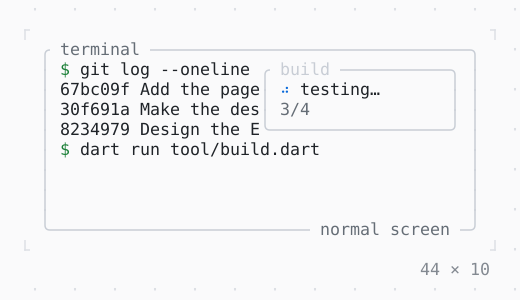

# Viewport

The app in a fixed rectangle of the screen (Viewport.fixed): nothing outside it is written, so what the terminal showed around it stays.

| Dark | Light |
| --- | --- |
|  |  |

## Code

The Dart that builds it, as the gallery's Code tab shows it with the
options as they start:

```dart
import 'dart:async';

import 'package:twk/twk.dart';

// the 20 × 4 cells from column 20 of row 0: nothing else is
// written, so what the terminal showed around them stays
void main() => runApp(
  const Build(),
  mode: ScreenMode.inline,
  viewport: const Viewport.fixed(20, 0, 20, 4),
);

final class Build extends StatefulWidget {
  const Build({super.key});

  @override
  State<Build> createState() => _BuildState();
}

final class _BuildState extends State<Build> {
  static const _steps = ['resolving', 'compiling', 'testing', 'writing'];

  var _done = 0;
  Timer? _timer;

  @override
  void initState() {
    super.initState();
    _timer = Timer.periodic(const Duration(milliseconds: 800), (_) => _step());
  }

  void _step() {
    if (_done == _steps.length) {
      // a tick after the last step: its frame stays in the cells
      _timer?.cancel();
      AppBinding.of(context).quit();
      return;
    }
    setState(() => _done++);
  }

  @override
  void dispose() {
    _timer?.cancel();
    super.dispose();
  }

  @override
  Widget build(BuildContext context) {
    final theme = Theme.of(context);
    final busy = _done < _steps.length;
    // laid out at the viewport's size, as a full screen of it
    return Box(
      border: .all(type: .rounded, style: theme.border),
      titles: const [BorderTitle(' build ')],
      padding: const .x(1),
      child: Column(
        crossAxisAlignment: .start,
        children: [
          if (busy)
            Row(gap: 1, children: [const Spinner(), Text('${_steps[_done]}…')])
          else
            Text.rich([Span('✓ ', theme.success), const Span('built')]),
          Text(
            '${busy ? _done + 1 : _done}/${_steps.length}',
            style: theme.muted,
          ),
        ],
      ),
    );
  }
}
```

## Options

What the gallery lets you change, and what each starts at:

| option | values | starts at |
| --- | --- | --- |
| left | 0 to 20 | 20 |
| top | 0 to 4 | 0 |
| mode | inline, fullscreen | inline |

## More

- Also in App: [InputListener](inputlistener.md), [ErrorWidget](errorwidget.md), [Static](static.md), [TerminalProgress](terminalprogress.md), [Window title](window-title.md), [Notifications](notifications.md), [Cli](cli.md).
- Live in the gallery:
  `dart run packages/gallery/bin/gallery.dart --route='#/app/viewport'`.
- [App](../app.md) · [All groups](../README.md)
