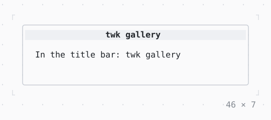

# Window title

The title of the terminal's window or tab while the app runs; the user's own comes back when it ends.

| Dark | Light |
| --- | --- |
|  |  |

## Code

The Dart that builds it, as the gallery's Code tab shows it with the
options as they start:

```dart
// the title of the terminal's window or tab while this is in the
// tree, set again when it changes: of nested ones the innermost, as
// Flutter's Title. The user's own comes back when the app ends.
return WindowTitle(
  title: 'twk gallery',
  child: const Text('In the title bar: twk gallery'),
);
```

## Options

What the gallery lets you change, and what each starts at:

| option | values | starts at |
| --- | --- | --- |
| title | twk gallery, build: 3 of 5, chat · ~/project | twk gallery |
| app running | on, off | true |

## More

- Also in App: [InputListener](inputlistener.md), [ErrorWidget](errorwidget.md), [Static](static.md), [TerminalProgress](terminalprogress.md), [Viewport](viewport.md), [Notifications](notifications.md), [Cli](cli.md).
- Live in the gallery:
  `dart run packages/gallery/bin/gallery.dart --route='#/app/window-title'`.
- [App](../app.md) · [All groups](../README.md)
