# Controls

Buttons, checkboxes and switches, choices, sliders, forms, tabs and status bars.

[All groups](README.md)

| | |
| --- | --- |
|  **[Button](controls/button.md)** A label pressed by a click, or by Enter or Space while it has the focus; disabled with no onPressed. | [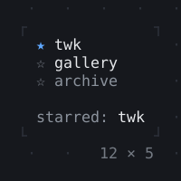](controls/pressable.md) **[Pressable](controls/pressable.md)** What the controls are built of: a node of the focus tree that Tab passes by while it is disabled, the keys it takes while it has the focus, a press that focuses it and a tap; it builds its look by whether it has the focus. |
| [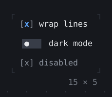](controls/checkbox-switch.md) **[Checkbox, Switch](controls/checkbox-switch.md)** What is on or off: a click, or Space or Enter, flips it. | [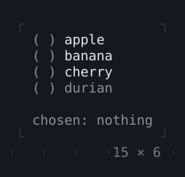](controls/radiogroup.md) **[RadioGroup](controls/radiogroup.md)** One of several choices: the arrows or a click choose one. |
| [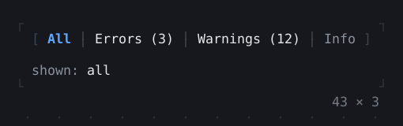](controls/segmentedbutton.md) **[SegmentedButton](controls/segmentedbutton.md)** A few values joined in one row, one on at a time or any of them: the arrows, a digit or a click turn one on. | [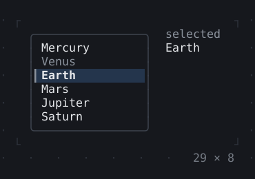](controls/selectionlist.md) **[SelectionList](controls/selectionlist.md)** Items selected by their keys: in a single selection the cursor selects, in a multiple one Space does. |
|  **[Select, MultiSelect](controls/select-multiselect.md)** A field that opens its choices to pick one, or several, from, or a PopupController from the app; typing filters them. | [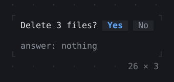](controls/confirminput.md) **[ConfirmInput](controls/confirminput.md)** A question answered by y, n or Enter. |
| [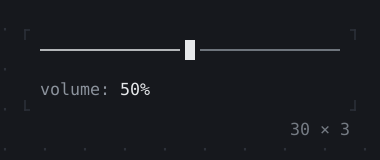](controls/slider.md) **[Slider](controls/slider.md)** A value along a track: the arrows, a press or a drag move the thumb, which stands in eighths of a cell. |  **[NumberInput](controls/numberinput.md)** A number typed, or stepped by Up and Down, the wheel or a click on ▴▾; kept within its bounds. |
|  **[DatePicker](controls/datepicker.md)** A date typed, stepped by Up and Down, or picked from the calendar that Alt+Down, a click on ▾ or a PopupController opens. |  **[FilePicker](controls/filepicker.md)** A file picked from the directory listed under a field that names its path: the arrows and Enter go through it, Tab completes a name; a FilePickerController goes to a directory. |
|  **[Form, FormField](controls/form-formfield.md)** Fields validated and submitted together: Enter goes on to the next field, and from the last submits the form. | [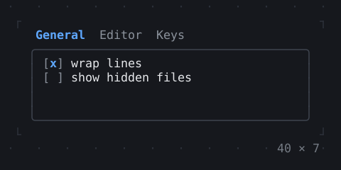](controls/tabbar-tabview.md) **[TabBar, TabView](controls/tabbar-tabview.md)** Tabs to pick a view by: Left and Right, or a click. |
|  **[KeyHintsBar](controls/keyhintsbar.md)** The keys that can be pressed now, with their hints, as the focus moves: Tab to the field to see its keys. |  **[StatusMessage, Badge](controls/statusmessage-badge.md)** A message of a kind after its icon, in its color; a short label on its color. |
| [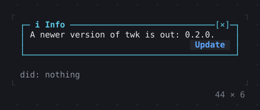](controls/callout.md) **[Callout](controls/callout.md)** A notice in a box lined in the color of its kind, its title on the top edge; [×] or Escape dismisses it, and buttons below act on it. | [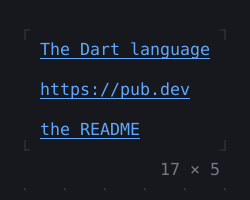](controls/link.md) **[Link](controls/link.md)** Text linked to a URL, which a terminal that knows hyperlinks opens. |
| [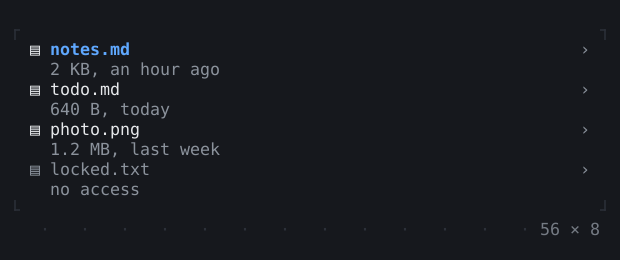](controls/listtile.md) **[ListTile](controls/listtile.md)** A row of a list: a title over a subtitle, something before and after them; tapped by a click or Enter, lit while focused or under the mouse. |  **[StatusBar](controls/statusbar.md)** A row of three sections, left, centre and right; those that do not fit give way, the centre first. |

