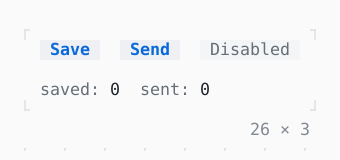

# Button

A label pressed by a click, or by Enter or Space while it has the focus; disabled with no onPressed.

| Dark | Light |
| --- | --- |
|  |  |

## Code

The Dart that builds it, as the gallery's Code tab shows it with the
options as they start:

```dart
var _saved = 0;
var _sent = 0;

// Button, as each control here, stands on
// Pressable: a node that Tab stops at unless it
// is disabled, the keys it binds while it has
// the focus (Enter, Space), a press that focuses
// it and a click.
@override
Widget build(BuildContext context) {
  final theme = Theme.of(context);
  return Column(
    mainAxisSize: .min,
    crossAxisAlignment: .start,
    gap: 1,
    children: [
      Row(
        mainAxisSize: .min,
        gap: 2,
        children: [
          Button('Save', onPressed: () => setState(() => _saved++)),
          Button('Send', onPressed: () => setState(() => _sent++)),
          const Button('Disabled', onPressed: null),
        ],
      ),
      Text.rich([
        Span('saved: ', theme.muted),
        Span('$_saved'),
        Span('  sent: ', theme.muted),
        Span('$_sent'),
      ]),
    ],
  );
}
```

## Options

What the gallery lets you change, and what each starts at:

| option | values | starts at |
| --- | --- | --- |
| style | primary, accent, success, warning, error, info | primary |
| look | chip, outlined, filled | chip |
| tall | on, off | false |

## More

- API: [`Button`](https://pub.dev/documentation/twk/latest/twk/Button-class.html).
- Also in Controls: [Pressable](pressable.md), [Checkbox, Switch](checkbox-switch.md), [RadioGroup](radiogroup.md), [SegmentedButton](segmentedbutton.md), [SelectionList](selectionlist.md), [Select, MultiSelect](select-multiselect.md), [ConfirmInput](confirminput.md), [Slider](slider.md), [NumberInput](numberinput.md), [DatePicker](datepicker.md), [FilePicker](filepicker.md), [Form, FormField](form-formfield.md), [TabBar, TabView](tabbar-tabview.md), [KeyHintsBar](keyhintsbar.md), [StatusMessage, Badge](statusmessage-badge.md), [Callout](callout.md), [Link](link.md), [ListTile](listtile.md), [StatusBar](statusbar.md).
- Live in the gallery:
  `dart run packages/gallery/bin/gallery.dart --route='#/controls/button'`.
- [Controls](../controls.md) · [All groups](../README.md)
