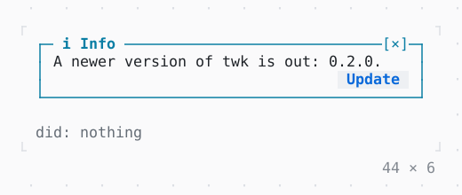

# Callout

A notice in a box lined in the color of its kind, its title on the top edge; [×] or Escape dismisses it, and buttons below act on it.

| Dark | Light |
| --- | --- |
|  |  |

## Code

The Dart that builds it, as the gallery's Code tab shows it with the
options as they start:

```dart
var _shown = true;
var _did = '';

@override
Widget build(BuildContext context) {
  final theme = Theme.of(context);
  return Column(
    mainAxisSize: .min,
    crossAxisAlignment: .start,
    gap: 1,
    children: [
      if (_shown)
        SizedBox(
          width: 44,
          child: Callout.text(
            'A newer version of twk is out: 0.2.0.',
            onDismissed: () => setState(() {
              _shown = false;
              _did = 'dismissed';
            }),
            actions: [
              Button(
                'Update',
                onPressed: () => setState(() => _did = 'update'),
              ),
            ],
          ),
        )
      else
        Button(
          'Show it again',
          onPressed: () => setState(() {
            _shown = true;
            _did = 'shown again';
          }),
        ),
      Text.rich([
        Span('did: ', theme.muted),
        if (_did.isEmpty)
          Span('nothing', theme.muted)
        else
          Span(_did),
      ]),
    ],
  );
}
```

## Options

What the gallery lets you change, and what each starts at:

| option | values | starts at |
| --- | --- | --- |
| kind | info, success, warning, error | info |
| dismissible | on, off | true |
| actions | on, off | true |
| title | kind, own | kind |
| icon | kind, own, none | kind |
| width | 24 cells to 60 cells | 44 |

## More

- API: [`Callout`](https://pub.dev/documentation/twk/latest/twk/Callout-class.html).
- Also in Controls: [Button](button.md), [Pressable](pressable.md), [Checkbox, Switch](checkbox-switch.md), [RadioGroup](radiogroup.md), [SegmentedButton](segmentedbutton.md), [SelectionList](selectionlist.md), [Select, MultiSelect](select-multiselect.md), [ConfirmInput](confirminput.md), [Slider](slider.md), [NumberInput](numberinput.md), [DatePicker](datepicker.md), [FilePicker](filepicker.md), [Form, FormField](form-formfield.md), [TabBar, TabView](tabbar-tabview.md), [KeyHintsBar](keyhintsbar.md), [StatusMessage, Badge](statusmessage-badge.md), [Link](link.md), [ListTile](listtile.md), [StatusBar](statusbar.md).
- Live in the gallery:
  `dart run packages/gallery/bin/gallery.dart --route='#/controls/callout'`.
- [Controls](../controls.md) · [All groups](../README.md)
