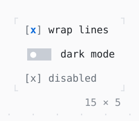

# Checkbox, Switch

What is on or off: a click, or Space or Enter, flips it.

| Dark | Light |
| --- | --- |
|  |  |

## Code

The Dart that builds it, as the gallery's Code tab shows it with the
options as they start:

```dart
var _wrap = true;
var _dark = false;

@override
Widget build(BuildContext context) => Column(
  mainAxisSize: .min,
  crossAxisAlignment: .start,
  gap: 1,
  children: [
    Checkbox(
      value: _wrap,
      label: 'wrap lines',
      onChanged: (value) => setState(() => _wrap = value),
    ),
    Switch(
      value: _dark,
      label: 'dark mode',
      onChanged: (value) => setState(() => _dark = value),
    ),
    const Checkbox(value: true, label: 'disabled', onChanged: null),
  ],
);
```

## Options

What the gallery lets you change, and what each starts at:

| option | values | starts at |
| --- | --- | --- |
| switch | pill, brackets | pill |

## More

- API: [`Checkbox`](https://pub.dev/documentation/twk/latest/twk/Checkbox-class.html), [`Switch`](https://pub.dev/documentation/twk/latest/twk/Switch-class.html).
- Also in Controls: [Button](button.md), [Pressable](pressable.md), [RadioGroup](radiogroup.md), [SegmentedButton](segmentedbutton.md), [SelectionList](selectionlist.md), [Select, MultiSelect](select-multiselect.md), [ConfirmInput](confirminput.md), [Slider](slider.md), [NumberInput](numberinput.md), [DatePicker](datepicker.md), [FilePicker](filepicker.md), [Form, FormField](form-formfield.md), [TabBar, TabView](tabbar-tabview.md), [KeyHintsBar](keyhintsbar.md), [StatusMessage, Badge](statusmessage-badge.md), [Callout](callout.md), [Link](link.md), [ListTile](listtile.md), [StatusBar](statusbar.md).
- Live in the gallery:
  `dart run packages/gallery/bin/gallery.dart --route='#/controls/checkbox-switch'`.
- [Controls](../controls.md) · [All groups](../README.md)
