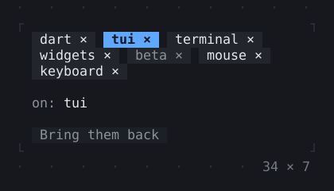
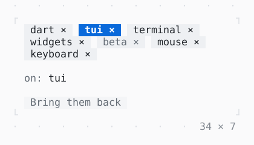

# Chip, ChipList

Tags on one row that wraps, with a cursor: the arrows move it, Space or a click toggles a chip, Delete or a click on its × removes it.

| Dark | Light |
| --- | --- |
|  |  |

## Code

The Dart that builds it, as the gallery's Code tab shows it with the
options as they start:

```dart
static const _all = [
  'dart',
  'tui',
  'terminal',
  'widgets',
  'beta',
  'mouse',
  'keyboard',
];

var _tags = _all;
var _on = {'tui'};

@override
Widget build(BuildContext context) {
  final theme = Theme.of(context);
  final shown = _on.where(_tags.contains);
  return Column(
    mainAxisSize: .min,
    crossAxisAlignment: .start,
    spacing: 1,
    children: [
      SizedBox(
        width: 34,
        child: ChipList<String>(
          chips: [
            for (final t in _tags) Choice(t, t, enabled: t != 'beta'),
          ],
          selected: _on,
          onSelectionChanged: (now) => setState(() => _on = now),
          onDeleted: (tag) {
            setState(() => _tags = [..._tags]..remove(tag));
          },
        ),
      ),
      Text.rich([
        Span('on: ', theme.muted),
        if (shown.isEmpty)
          Span('nothing', theme.muted)
        else
          Span(shown.join(', ')),
      ]),
      Button(
        'Bring them back',
        onPressed: _tags.length == _all.length
            ? null
            : () => setState(() => _tags = _all),
      ),
    ],
  );
}
```

## Options

What the gallery lets you change, and what each starts at:

| option | values | starts at |
| --- | --- | --- |
| toggle | on, off | true |
| removable | on, off | true |
| width | 20 cells to 50 cells | 34 |

## More

- API: [`Chip`](https://pub.dev/documentation/twk/latest/twk/Chip-class.html), [`ChipList`](https://pub.dev/documentation/twk/latest/twk/ChipList-class.html).
- Also in Controls: [Button](button.md), [Pressable](pressable.md), [Checkbox, Switch](checkbox-switch.md), [RadioGroup](radiogroup.md), [SegmentedButton](segmentedbutton.md), [ValueStepper](valuestepper.md), [SelectionList](selectionlist.md), [Select, MultiSelect](select-multiselect.md), [ConfirmInput](confirminput.md), [Slider](slider.md), [NumberInput](numberinput.md), [DatePicker](datepicker.md), [FilePicker](filepicker.md), [Form, FormField](form-formfield.md), [TabBar, TabView](tabbar-tabview.md), [KeyHintsBar](keyhintsbar.md), [StatusMessage, Badge](statusmessage-badge.md), [Callout](callout.md), [Hyperlink](hyperlink.md), [ListTile](listtile.md), [StatusBar](statusbar.md).
- Live in the gallery:
  `dart run packages/gallery/bin/gallery.dart --route='#/controls/chip-chiplist'`.
- [Controls](../controls.md) · [All groups](../README.md)
