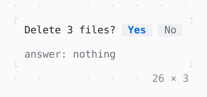

# ConfirmInput

A question answered by y, n or Enter.

| Dark | Light |
| --- | --- |
|  |  |

## Code

The Dart that builds it, as the gallery's Code tab shows it with the
options as they start:

```dart
bool? _answer;

@override
Widget build(BuildContext context) => Column(
  mainAxisSize: .min,
  crossAxisAlignment: .start,
  gap: 1,
  children: [
    ConfirmInput(
      'Delete 3 files?',
      // it reads defaultValue once: another is a new input
      key: const ValueKey(true),
      defaultValue: true,
      onConfirmed: (yes) => setState(() => _answer = yes),
    ),
    Text.rich([
      Span('answer: ', Theme.of(context).muted),
      switch (_answer) {
        null => Span('nothing', Theme.of(context).muted),
        true => const Span('yes'),
        false => const Span('no'),
      },
    ]),
  ],
);
```

## Options

What the gallery lets you change, and what each starts at:

| option | values | starts at |
| --- | --- | --- |
| default | yes, no | yes |
| answers | Yes, No, Delete, Keep | Yes, No |

## More

- API: [`ConfirmInput`](https://pub.dev/documentation/twk/latest/twk/ConfirmInput-class.html).
- Also in Controls: [Button](button.md), [Pressable](pressable.md), [Checkbox, Switch](checkbox-switch.md), [RadioGroup](radiogroup.md), [SegmentedButton](segmentedbutton.md), [SelectionList](selectionlist.md), [Select, MultiSelect](select-multiselect.md), [Slider](slider.md), [NumberInput](numberinput.md), [DatePicker](datepicker.md), [FilePicker](filepicker.md), [Form, FormField](form-formfield.md), [TabBar, TabView](tabbar-tabview.md), [KeyHintsBar](keyhintsbar.md), [StatusMessage, Badge](statusmessage-badge.md), [Callout](callout.md), [Link](link.md), [ListTile](listtile.md), [StatusBar](statusbar.md).
- Live in the gallery:
  `dart run packages/gallery/bin/gallery.dart --route='#/controls/confirminput'`.
- [Controls](../controls.md) · [All groups](../README.md)
