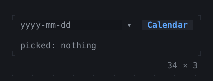
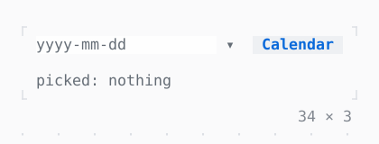

# DatePicker

A date typed, stepped by Up and Down, or picked from the calendar that Alt+Down, a click on ▾ or a PopupController opens.

| Dark | Light |
| --- | --- |
|  |  |

## Code

The Dart that builds it, as the gallery's Code tab shows it with the
options as they start:

```dart
final _calendar = PopupController();
DateTime? _date;

static const _days = [
  'Monday',
  'Tuesday',
  'Wednesday',
  'Thursday',
  'Friday',
  'Saturday',
  'Sunday',
];

@override
void dispose() {
  _calendar.dispose();
  super.dispose();
}

@override
Widget build(BuildContext context) => Column(
  mainAxisSize: .min,
  crossAxisAlignment: .start,
  gap: 1,
  children: [
    Row(
      mainAxisSize: .min,
      gap: 2,
      children: [
        SizedBox(
          width: 22,
          child: DatePicker(
            value: _date,
            firstDate: DateTime(2026),
            lastDate: DateTime(2026, 12, 31),
            today: DateTime(2026, 10, 19),
            controller: _calendar,
            onChanged: (date) => setState(() => _date = date),
          ),
        ),
        // opens the calendar, the focus in it
        Button('Calendar', onPressed: _calendar.open),
      ],
    ),
    Text.rich([
      Span('picked: ', Theme.of(context).muted),
      switch (_date) {
        null => Span('nothing', Theme.of(context).muted),
        final date => Span(
          '${_days[date.weekday - 1]}, ${date.day} '
          '${Calendar.englishMonthNames[date.month - 1]}',
        ),
      },
    ]),
  ],
);
```

## Options

What the gallery lets you change, and what each starts at:

| option | values | starts at |
| --- | --- | --- |
| time of day | on, off | false |
| weeks start | monday, sunday | monday |
| popup look | raised, bordered | raised |

## More

- API: [`DatePicker`](https://pub.dev/documentation/twk/latest/twk/DatePicker-class.html).
- Also in Controls: [Button](button.md), [Pressable](pressable.md), [Checkbox, Switch](checkbox-switch.md), [RadioGroup](radiogroup.md), [SegmentedButton](segmentedbutton.md), [SelectionList](selectionlist.md), [Select, MultiSelect](select-multiselect.md), [ConfirmInput](confirminput.md), [Slider](slider.md), [NumberInput](numberinput.md), [FilePicker](filepicker.md), [Form, FormField](form-formfield.md), [TabBar, TabView](tabbar-tabview.md), [KeyHintsBar](keyhintsbar.md), [StatusMessage, Badge](statusmessage-badge.md), [Callout](callout.md), [Link](link.md), [ListTile](listtile.md), [StatusBar](statusbar.md).
- Live in the gallery:
  `dart run packages/gallery/bin/gallery.dart --route='#/controls/datepicker'`.
- [Controls](../controls.md) · [All groups](../README.md)
