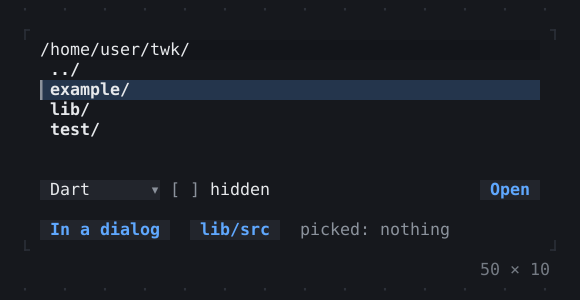
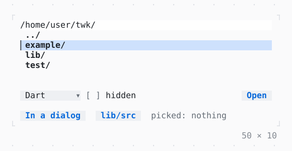

# FilePicker

A file picked from the directory listed under a field that names its path: the arrows and Enter go through it, Tab completes a name; a FilePickerController goes to a directory.

| Dark | Light |
| --- | --- |
|  |  |

## Code

The Dart that builds it, as the gallery's Code tab shows it with the
options as they start:

```dart
final _files = FilePickerController();
String? _picked;

@override
void dispose() {
  _files.dispose();
  super.dispose();
}

static const _filters = [
  FileFilter('Dart', ['dart']),
  FileFilter('All files'),
];

void _show(List<String>? paths) {
  if (mounted && paths != null) {
    setState(() => _picked = paths.join(', '));
  }
}

@override
Widget build(BuildContext context) {
  final theme = Theme.of(context);
  return SizedBox(
    width: 50,
    child: Column(
      mainAxisSize: .min,
      crossAxisAlignment: .stretch,
      gap: 1,
      children: [
        SizedBox(
          height: 8,
          // a picker for each mode: it reads its mode once
          child: FilePicker(
            key: const ValueKey('open'),
            controller: _files,
            filters: _filters,
            onPicked: _show,
          ),
        ),
        Row(
          crossAxisAlignment: .start,
          gap: 2,
          children: [
            Button(
              'In a dialog',
              onPressed: () => unawaited(
                showFilePicker(context, filters: _filters).then(_show),
              ),
            ),
            // the picker above gone there, the name typed kept
            Button('lib/src', onPressed: () => _files.goTo('~/twk/lib/src')),
            Expanded(
              child: Text.rich(
                [
                  Span('picked: ', theme.muted),
                  if (_picked case final picked?)
                    Span(picked)
                  else
                    Span('nothing', theme.muted),
                ],
                maxLines: 2,
                overflow: .ellipsis,
              ),
            ),
          ],
        ),
      ],
    ),
  );
}
```

## Options

What the gallery lets you change, and what each starts at:

| option | values | starts at |
| --- | --- | --- |
| mode | open, open several, save, directory | open |
| show hidden | on, off | false |

## More

- API: [`FilePicker`](https://pub.dev/documentation/twk/latest/twk/FilePicker-class.html).
- Also in Controls: [Button](button.md), [Pressable](pressable.md), [Checkbox, Switch](checkbox-switch.md), [RadioGroup](radiogroup.md), [SegmentedButton](segmentedbutton.md), [SelectionList](selectionlist.md), [Select, MultiSelect](select-multiselect.md), [ConfirmInput](confirminput.md), [Slider](slider.md), [NumberInput](numberinput.md), [DatePicker](datepicker.md), [Form, FormField](form-formfield.md), [TabBar, TabView](tabbar-tabview.md), [KeyHintsBar](keyhintsbar.md), [StatusMessage, Badge](statusmessage-badge.md), [Callout](callout.md), [Link](link.md), [ListTile](listtile.md), [StatusBar](statusbar.md).
- Live in the gallery:
  `dart run packages/gallery/bin/gallery.dart --route='#/controls/filepicker'`.
- [Controls](../controls.md) · [All groups](../README.md)
