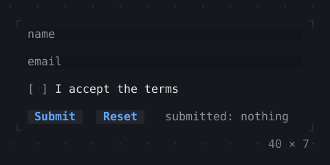
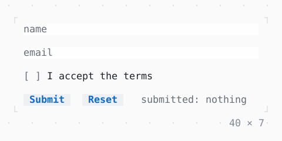

# Form, FormField

Fields validated and submitted together: Enter goes on to the next field, and from the last submits the form.

| Dark | Light |
| --- | --- |
|  |  |

## Code

The Dart that builds it, as the gallery's Code tab shows it with the
options as they start:

```dart
final _form = GlobalKey<FormState>();
String? _submitted;
var _name = '';

@override
Widget build(BuildContext context) => Form(
  key: _form,
  onSubmitted: () => setState(() => _submitted = _name),
  child: SizedBox(
    width: 40,
    child: Column(
      mainAxisSize: .min,
      crossAxisAlignment: .stretch,
      gap: 1,
      children: [
        TextFormField(
          placeholder: 'name',
          validator: (name) => name!.isEmpty ? 'a name, please' : null,
          onSaved: (name) => _name = name!,
        ),
        TextFormField(
          placeholder: 'email',
          validator: (email) =>
              email!.contains('@') ? null : 'an email has an @ in it',
        ),
        FormField<bool>(
          initialValue: false,
          validator: (accepted) =>
              accepted! ? null : 'the terms are to be accepted',
          builder: (field) => Checkbox(
            value: field.value!,
            onChanged: field.didChange,
            label: 'I accept the terms',
          ),
        ),
        Row(
          gap: 2,
          children: [
            Button('Submit', onPressed: () => _form.currentState!.submit()),
            Button('Reset', onPressed: () => _form.currentState!.reset()),
            Expanded(
              child: Text.rich(
                [
                  Span(' submitted: ', Theme.of(context).muted),
                  if (_submitted case final submitted?)
                    Span(submitted)
                  else
                    Span('nothing', Theme.of(context).muted),
                ],
                wrap: .none,
                overflow: .ellipsis,
              ),
            ),
          ],
        ),
      ],
    ),
  ),
);
```

## Options

What the gallery lets you change, and what each starts at:

| option | values | starts at |
| --- | --- | --- |
| validate | disabled, always, onUserInteraction, onUnfocus | disabled |

## More

- API: [`Form`](https://pub.dev/documentation/twk/latest/twk/Form-class.html), [`FormField`](https://pub.dev/documentation/twk/latest/twk/FormField-class.html).
- Also in Controls: [Button](button.md), [Pressable](pressable.md), [Checkbox, Switch](checkbox-switch.md), [RadioGroup](radiogroup.md), [SegmentedButton](segmentedbutton.md), [SelectionList](selectionlist.md), [Select, MultiSelect](select-multiselect.md), [ConfirmInput](confirminput.md), [Slider](slider.md), [NumberInput](numberinput.md), [DatePicker](datepicker.md), [FilePicker](filepicker.md), [TabBar, TabView](tabbar-tabview.md), [KeyHintsBar](keyhintsbar.md), [StatusMessage, Badge](statusmessage-badge.md), [Callout](callout.md), [Link](link.md), [ListTile](listtile.md), [StatusBar](statusbar.md).
- Live in the gallery:
  `dart run packages/gallery/bin/gallery.dart --route='#/controls/form-formfield'`.
- [Controls](../controls.md) · [All groups](../README.md)
