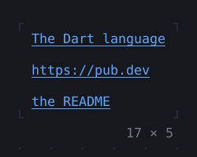
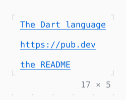

# Hyperlink

Text linked to a URL, which a terminal that knows hyperlinks opens.

| Dark | Light |
| --- | --- |
|  |  |

## Code

The Dart that builds it, as the gallery's Code tab shows it with the
options as they start:

```dart
return const Column(
  mainAxisSize: .min,
  crossAxisAlignment: .start,
  gap: 1,
  children: [
    Hyperlink('https://dart.dev', text: 'The Dart language'),
    Hyperlink('https://pub.dev'),
    Hyperlink('file:///home/user/twk/README.md', text: 'the README'),
  ],
);
```

## Options

What the gallery lets you change, and what each starts at:

| option | values | starts at |
| --- | --- | --- |
| style | primary, accent, info | primary |
| shows | text, url | text |

## More

- API: [`Hyperlink`](https://pub.dev/documentation/twk/latest/twk/Hyperlink-class.html).
- Also in Controls: [Button](button.md), [Pressable](pressable.md), [Checkbox, Switch](checkbox-switch.md), [RadioGroup](radiogroup.md), [SegmentedButton](segmentedbutton.md), [Chip, ChipList](chip-chiplist.md), [ValueStepper](valuestepper.md), [SelectionList](selectionlist.md), [Select, MultiSelect](select-multiselect.md), [ConfirmInput](confirminput.md), [Slider](slider.md), [NumberInput](numberinput.md), [DatePicker](datepicker.md), [FilePicker](filepicker.md), [Form, FormField](form-formfield.md), [TabBar, TabView](tabbar-tabview.md), [KeyHintsBar](keyhintsbar.md), [StatusMessage, Badge](statusmessage-badge.md), [Callout](callout.md), [ListTile](listtile.md), [StatusBar](statusbar.md).
- Live in the gallery:
  `dart run packages/gallery/bin/gallery.dart --route='#/controls/hyperlink'`.
- [Controls](../controls.md) · [All groups](../README.md)
