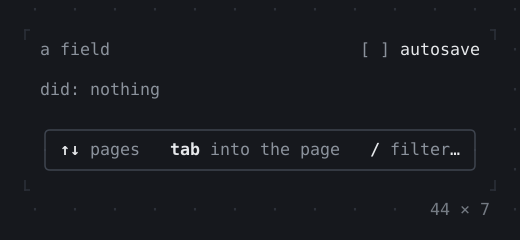
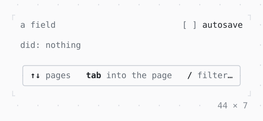

# KeyHintsBar

The keys that can be pressed now, with their hints, as the focus moves: Tab to the field to see its keys.

| Dark | Light |
| --- | --- |
|  |  |

## Code

The Dart that builds it, as the gallery's Code tab shows it with the
options as they start:

```dart
String? _did;
var _autosave = false;

void _do(String what) => setState(() => _did = what);

@override
Widget build(BuildContext context) {
  final theme = Theme.of(context);
  return KeyBindings(
    {
      'ctrl+s': () => _do('save'),
      'ctrl+x ctrl+o': () => _do('open'),
      'f2': () => _do('rename'),
    },
    hints: const {'ctrl+s': 'save', 'ctrl+x ctrl+o': 'open'},
    child: SizedBox(
      width: 44,
      child: Column(
        mainAxisSize: .min,
        crossAxisAlignment: .stretch,
        gap: 1,
        children: [
          Row(
            gap: 2,
            children: [
              // a field without a box shows the focus on the selection
              Expanded(
                child: TextField(
                  placeholder: 'a field',
                  focusedStyle: theme.selection,
                ),
              ),
              Checkbox(
                value: _autosave,
                label: 'autosave',
                onChanged: (on) => setState(() => _autosave = on),
              ),
            ],
          ),
          Text.rich([
            Span('did: ', theme.muted),
            if (_did case final did?)
              Span(did)
            else
              Span('nothing', theme.muted),
          ]),
          Box(
            border: .all(type: .rounded, style: theme.border),
            padding: const .x(1),
            child: const KeyHintsBar(),
          ),
        ],
      ),
    ),
  );
}
```

## Options

What the gallery lets you change, and what each starts at:

| option | values | starts at |
| --- | --- | --- |
| unhinted keys | on, off | false |
| join keys | on, off | true |
| keys named by | signs, names | signs |
| separator | blanks, dot, line | blanks |

## More

- API: [`KeyHintsBar`](https://pub.dev/documentation/twk/latest/twk/KeyHintsBar-class.html).
- Also in Controls: [Button](button.md), [Pressable](pressable.md), [Checkbox, Switch](checkbox-switch.md), [RadioGroup](radiogroup.md), [SegmentedButton](segmentedbutton.md), [SelectionList](selectionlist.md), [Select, MultiSelect](select-multiselect.md), [ConfirmInput](confirminput.md), [Slider](slider.md), [NumberInput](numberinput.md), [DatePicker](datepicker.md), [FilePicker](filepicker.md), [Form, FormField](form-formfield.md), [TabBar, TabView](tabbar-tabview.md), [StatusMessage, Badge](statusmessage-badge.md), [Callout](callout.md), [Link](link.md), [ListTile](listtile.md), [StatusBar](statusbar.md).
- Live in the gallery:
  `dart run packages/gallery/bin/gallery.dart --route='#/controls/keyhintsbar'`.
- [Controls](../controls.md) · [All groups](../README.md)
