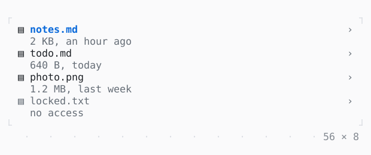

# ListTile

A row of a list: a title over a subtitle, something before and after them; tapped by a click or Enter, lit while focused or under the mouse.

| Dark | Light |
| --- | --- |
|  |  |

## Code

The Dart that builds it, as the gallery's Code tab shows it with the
options as they start:

```dart
var _open = 0;

@override
Widget build(BuildContext context) {
  const files = [
    ('notes.md', '2 KB, an hour ago'),
    ('todo.md', '640 B, today'),
    ('photo.png', '1.2 MB, last week'),
    ('locked.txt', 'no access'),
  ];
  return Column(
    mainAxisSize: .min,
    children: [
      for (final (i, (name, about)) in files.indexed)
        ListTile(
          leading: const Text('▤'),
          title: Text(name),
          subtitle: Text(about),
          trailing: const Text('›'),
          selected: i == _open,
          enabled: i != 3,
          onTap: () => setState(() => _open = i),
        ),
    ],
  );
}
```

## Options

What the gallery lets you change, and what each starts at:

| option | values | starts at |
| --- | --- | --- |
| leading | on, off | true |
| subtitle | on, off | true |
| trailing | on, off | true |

## More

- API: [`ListTile`](https://pub.dev/documentation/twk/latest/twk/ListTile-class.html).
- Also in Controls: [Button](button.md), [Pressable](pressable.md), [Checkbox, Switch](checkbox-switch.md), [RadioGroup](radiogroup.md), [SegmentedButton](segmentedbutton.md), [SelectionList](selectionlist.md), [Select, MultiSelect](select-multiselect.md), [ConfirmInput](confirminput.md), [Slider](slider.md), [NumberInput](numberinput.md), [DatePicker](datepicker.md), [FilePicker](filepicker.md), [Form, FormField](form-formfield.md), [TabBar, TabView](tabbar-tabview.md), [KeyHintsBar](keyhintsbar.md), [StatusMessage, Badge](statusmessage-badge.md), [Callout](callout.md), [Link](link.md), [StatusBar](statusbar.md).
- Live in the gallery:
  `dart run packages/gallery/bin/gallery.dart --route='#/controls/listtile'`.
- [Controls](../controls.md) · [All groups](../README.md)
