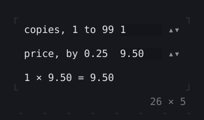
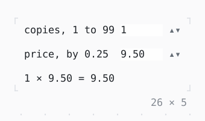

# NumberInput

A number typed, or stepped by Up and Down, the wheel or a click on ▴▾; kept within its bounds.

| Dark | Light |
| --- | --- |
|  |  |

## Code

The Dart that builds it, as the gallery's Code tab shows it with the
options as they start:

```dart
var _copies = 1.0;
var _price = 9.5;

@override
Widget build(BuildContext context) => Column(
  mainAxisSize: .min,
  crossAxisAlignment: .start,
  gap: 1,
  children: [
    Row(
      mainAxisSize: .min,
      children: [
        const SizedBox(width: 16, child: Text('copies, 1 to 99')),
        SizedBox(
          width: 10,
          child: NumberInput(
            value: _copies,
            min: 1,
            max: 99,
            onChanged: (value) => setState(() => _copies = value),
          ),
        ),
      ],
    ),
    Row(
      mainAxisSize: .min,
      children: [
        const SizedBox(width: 16, child: Text('price, by 0.25')),
        SizedBox(
          width: 10,
          child: NumberInput(
            value: _price,
            min: 0,
            step: 0.25,
            decimals: 2,
            onChanged: (value) => setState(() => _price = value),
          ),
        ),
      ],
    ),
    Text(
      '${_copies.round()} × ${_price.toStringAsFixed(2)} = '
      '${(_copies * _price).toStringAsFixed(2)}',
    ),
  ],
);
```

## More

- API: [`NumberInput`](https://pub.dev/documentation/twk/latest/twk/NumberInput-class.html).
- Also in Controls: [Button](button.md), [Pressable](pressable.md), [Checkbox, Switch](checkbox-switch.md), [RadioGroup](radiogroup.md), [SegmentedButton](segmentedbutton.md), [SelectionList](selectionlist.md), [Select, MultiSelect](select-multiselect.md), [ConfirmInput](confirminput.md), [Slider](slider.md), [DatePicker](datepicker.md), [FilePicker](filepicker.md), [Form, FormField](form-formfield.md), [TabBar, TabView](tabbar-tabview.md), [KeyHintsBar](keyhintsbar.md), [StatusMessage, Badge](statusmessage-badge.md), [Callout](callout.md), [Link](link.md), [ListTile](listtile.md), [StatusBar](statusbar.md).
- Live in the gallery:
  `dart run packages/gallery/bin/gallery.dart --route='#/controls/numberinput'`.
- [Controls](../controls.md) · [All groups](../README.md)
