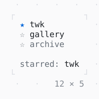

# Pressable

What the controls are built of: a node of the focus tree that Tab passes by while it is disabled, the keys it takes while it has the focus, a press that focuses it and a tap; it builds its look by whether it has the focus.

| Dark | Light |
| --- | --- |
|  |  |

## Code

The Dart that builds it, as the gallery's Code tab shows it with the
options as they start:

```dart
final _starred = {'twk'};

void _toggle(String name) => setState(() {
  if (!_starred.remove(name)) {
    _starred.add(name);
  }
});

// A row that stars [name], made of a Pressable: Tab
// stops at it unless it is disabled, its bindings
// are the keys it takes while it has the focus, a
// press focuses it and a tap calls onTap; it
// builds its look by whether it has the focus.
Widget _star(String name, {bool enabled = true}) => Pressable(
  enabled: enabled,
  bindings: {'space': () => _toggle(name)},
  hints: const {'space': 'star'},
  onTap: enabled ? (_) => _toggle(name) : null,
  builder: (context, focused) {
    final theme = Theme.of(context);
    final on = _starred.contains(name);
    return Text.rich(
      [
        Span(
          on ? '★' : '☆',
          on ? theme.primary.merge(const .new(attrs: Attr.bold)) : theme.muted,
        ),
        Span(' $name'),
      ],
      style: !enabled
          ? theme.muted
          : focused
          ? theme.selection
          : const .new(),
    );
  },
);

@override
Widget build(BuildContext context) {
  final theme = Theme.of(context);
  return Column(
    mainAxisSize: .min,
    crossAxisAlignment: .start,
    gap: 1,
    children: [
      Column(
        mainAxisSize: .min,
        crossAxisAlignment: .start,
        children: [
          _star('twk'),
          _star('gallery'),
          _star('archive', enabled: false),
        ],
      ),
      Text.rich([
        Span('starred: ', theme.muted),
        if (_starred.isEmpty)
          Span('nothing', theme.muted)
        else
          Span(_starred.join(', ')),
      ]),
    ],
  );
}
```

## Options

What the gallery lets you change, and what each starts at:

| option | values | starts at |
| --- | --- | --- |
| style | primary, accent, success, warning, error, info | primary |

## More

- API: [`Pressable`](https://pub.dev/documentation/twk/latest/twk/Pressable-class.html).
- Also in Controls: [Button](button.md), [Checkbox, Switch](checkbox-switch.md), [RadioGroup](radiogroup.md), [SegmentedButton](segmentedbutton.md), [SelectionList](selectionlist.md), [Select, MultiSelect](select-multiselect.md), [ConfirmInput](confirminput.md), [Slider](slider.md), [NumberInput](numberinput.md), [DatePicker](datepicker.md), [FilePicker](filepicker.md), [Form, FormField](form-formfield.md), [TabBar, TabView](tabbar-tabview.md), [KeyHintsBar](keyhintsbar.md), [StatusMessage, Badge](statusmessage-badge.md), [Callout](callout.md), [Link](link.md), [ListTile](listtile.md), [StatusBar](statusbar.md).
- Live in the gallery:
  `dart run packages/gallery/bin/gallery.dart --route='#/controls/pressable'`.
- [Controls](../controls.md) · [All groups](../README.md)
