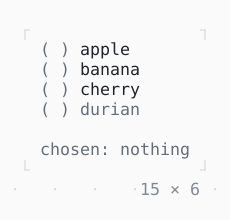

# RadioGroup

One of several choices: the arrows or a click choose one.

| Dark | Light |
| --- | --- |
|  |  |

## Code

The Dart that builds it, as the gallery's Code tab shows it with the
options as they start:

```dart
const _fruit = [
  Choice('apple', 'apple'),
  Choice('banana', 'banana'),
  Choice('cherry', 'cherry'),
  Choice('durian', 'durian', enabled: false),
];

String? _chosen;

@override
Widget build(BuildContext context) {
  final theme = Theme.of(context);
  return Column(
    mainAxisSize: .min,
    crossAxisAlignment: .start,
    gap: 1,
    children: [
      RadioGroup<String>(
        choices: _fruit,
        value: _chosen,
        direction: .vertical,
        onChanged: (value) => setState(() => _chosen = value),
      ),
      Text.rich([
        Span('chosen: ', theme.muted),
        if (_chosen case final chosen?)
          Span(chosen)
        else
          Span('nothing', theme.muted),
      ]),
    ],
  );
}
```

## Options

What the gallery lets you change, and what each starts at:

| option | values | starts at |
| --- | --- | --- |
| direction | vertical, horizontal | vertical |

## More

- API: [`RadioGroup`](https://pub.dev/documentation/twk/latest/twk/RadioGroup-class.html).
- Also in Controls: [Button](button.md), [Pressable](pressable.md), [Checkbox, Switch](checkbox-switch.md), [SegmentedButton](segmentedbutton.md), [SelectionList](selectionlist.md), [Select, MultiSelect](select-multiselect.md), [ConfirmInput](confirminput.md), [Slider](slider.md), [NumberInput](numberinput.md), [DatePicker](datepicker.md), [FilePicker](filepicker.md), [Form, FormField](form-formfield.md), [TabBar, TabView](tabbar-tabview.md), [KeyHintsBar](keyhintsbar.md), [StatusMessage, Badge](statusmessage-badge.md), [Callout](callout.md), [Link](link.md), [ListTile](listtile.md), [StatusBar](statusbar.md).
- Live in the gallery:
  `dart run packages/gallery/bin/gallery.dart --route='#/controls/radiogroup'`.
- [Controls](../controls.md) · [All groups](../README.md)
