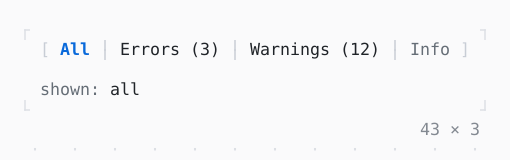

# SegmentedButton

A few values joined in one row, one on at a time or any of them: the arrows, a digit or a click turn one on.

| Dark | Light |
| --- | --- |
|  |  |

## Code

The Dart that builds it, as the gallery's Code tab shows it with the
options as they start:

```dart
var _shown = {'all'};

@override
Widget build(BuildContext context) {
  final theme = Theme.of(context);
  return Column(
    mainAxisSize: .min,
    crossAxisAlignment: .start,
    gap: 1,
    children: [
      SegmentedButton<String>(
        segments: const [
          Choice('all', 'All'),
          Choice('errors', 'Errors (3)'),
          Choice('warnings', 'Warnings (12)'),
          Choice('info', 'Info', enabled: false),
        ],
        selected: _shown,
        onSelectionChanged: (shown) => setState(() => _shown = shown),
      ),
      Text.rich([
        Span('shown: ', theme.muted),
        if (_shown.isEmpty)
          Span('nothing', theme.muted)
        else
          Span(_shown.join(', ')),
      ]),
    ],
  );
}
```

## Options

What the gallery lets you change, and what each starts at:

| option | values | starts at |
| --- | --- | --- |
| multiple | on, off | false |
| allow none | on, off | false |
| selected icon | on, off | false |
| caps | square, round | square |

## More

- API: [`SegmentedButton`](https://pub.dev/documentation/twk/latest/twk/SegmentedButton-class.html).
- Also in Controls: [Button](button.md), [Pressable](pressable.md), [Checkbox, Switch](checkbox-switch.md), [RadioGroup](radiogroup.md), [SelectionList](selectionlist.md), [Select, MultiSelect](select-multiselect.md), [ConfirmInput](confirminput.md), [Slider](slider.md), [NumberInput](numberinput.md), [DatePicker](datepicker.md), [FilePicker](filepicker.md), [Form, FormField](form-formfield.md), [TabBar, TabView](tabbar-tabview.md), [KeyHintsBar](keyhintsbar.md), [StatusMessage, Badge](statusmessage-badge.md), [Callout](callout.md), [Link](link.md), [ListTile](listtile.md), [StatusBar](statusbar.md).
- Live in the gallery:
  `dart run packages/gallery/bin/gallery.dart --route='#/controls/segmentedbutton'`.
- [Controls](../controls.md) · [All groups](../README.md)
