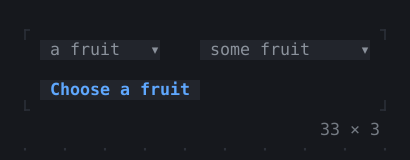
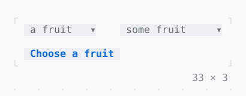

# Select, MultiSelect

A field that opens its choices to pick one, or several, from, or a PopupController from the app; typing filters them.

| Dark | Light |
| --- | --- |
|  |  |

## Code

The Dart that builds it, as the gallery's Code tab shows it with the
options as they start:

```dart
const _fruit = [
  Choice('apple', 'apple'),
  Choice('apricot', 'apricot'),
  Choice('banana', 'banana'),
  Choice('blueberry', 'blueberry'),
  Choice('cherry', 'cherry'),
  Choice('durian', 'durian', enabled: false),
  Choice('fig', 'fig'),
  Choice('grape', 'grape'),
  Choice('lemon', 'lemon'),
];

final _popup = PopupController();
String? _one;
var _some = <String>{};

@override
void dispose() {
  _popup.dispose();
  super.dispose();
}

// Open, each shows its choices in an OptionList,
// as Autocomplete and CommandPalette do: the
// letters typed lit, the highlighted one on the
// selection.
@override
Widget build(BuildContext context) => Column(
  mainAxisSize: .min,
  crossAxisAlignment: .start,
  gap: 1,
  children: [
    Row(
      mainAxisSize: .min,
      crossAxisAlignment: .start,
      gap: 4,
      children: [
        Select<String>(
          choices: _fruit,
          value: _one,
          hint: 'a fruit',
          rows: 4,
          controller: _popup,
          onChanged: (value) => setState(() => _one = value),
        ),
        MultiSelect<String>(
          choices: _fruit,
          values: _some,
          hint: 'some fruit',
          rows: 4,
          onChanged: (values) => setState(() => _some = values),
        ),
      ],
    ),
    // opens the fruit's list, the focus in its field
    Button('Choose a fruit', onPressed: _popup.open),
  ],
);
```

## Options

What the gallery lets you change, and what each starts at:

| option | values | starts at |
| --- | --- | --- |
| inline | on, off | false |
| rows | 4, 8 | 4 |
| popup look | raised, bordered | raised |

## More

- API: [`Select`](https://pub.dev/documentation/twk/latest/twk/Select-class.html), [`MultiSelect`](https://pub.dev/documentation/twk/latest/twk/MultiSelect-class.html).
- Also in Controls: [Button](button.md), [Pressable](pressable.md), [Checkbox, Switch](checkbox-switch.md), [RadioGroup](radiogroup.md), [SegmentedButton](segmentedbutton.md), [SelectionList](selectionlist.md), [ConfirmInput](confirminput.md), [Slider](slider.md), [NumberInput](numberinput.md), [DatePicker](datepicker.md), [FilePicker](filepicker.md), [Form, FormField](form-formfield.md), [TabBar, TabView](tabbar-tabview.md), [KeyHintsBar](keyhintsbar.md), [StatusMessage, Badge](statusmessage-badge.md), [Callout](callout.md), [Link](link.md), [ListTile](listtile.md), [StatusBar](statusbar.md).
- Live in the gallery:
  `dart run packages/gallery/bin/gallery.dart --route='#/controls/select-multiselect'`.
- [Controls](../controls.md) · [All groups](../README.md)
